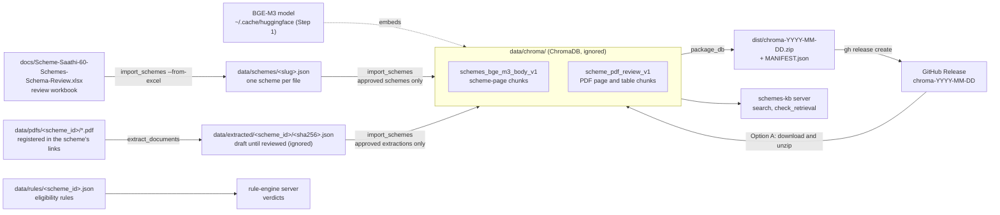
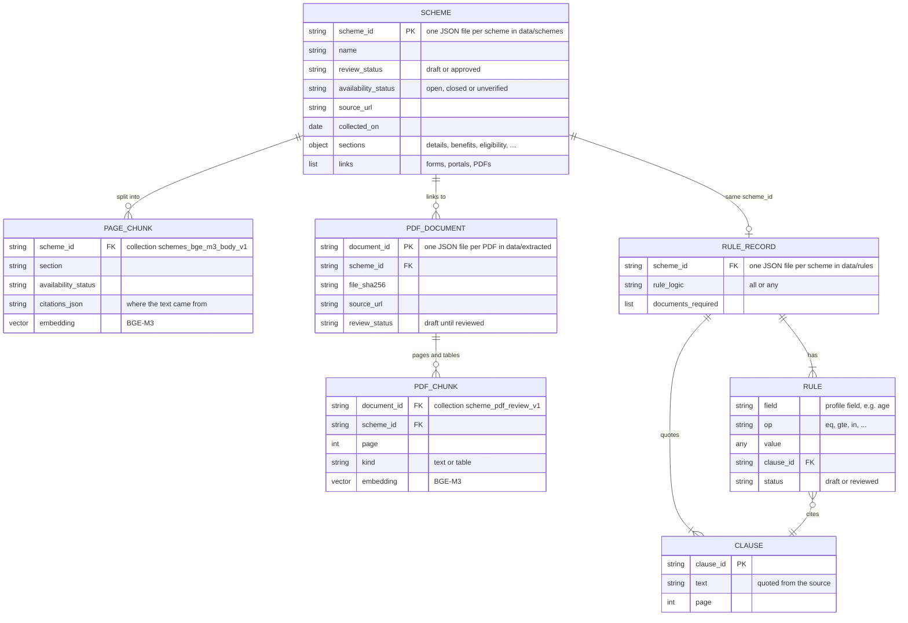
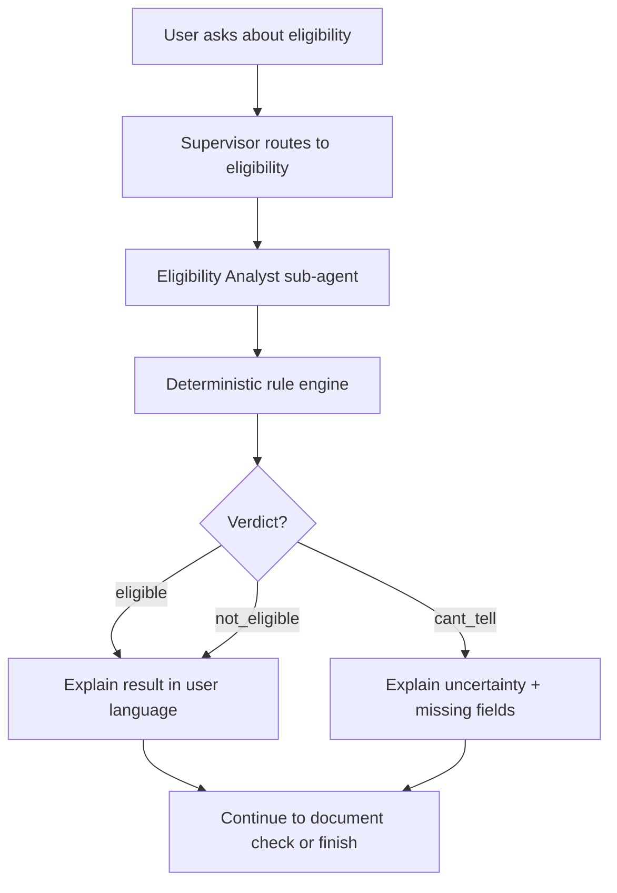

# Scheme Saathi

A welfare-scheme navigator for citizens and CSC operators. It identifies eligible government schemes, explains the reasons in the user's language, and prepares an application for a person to approve before submission.

## Layout

- `servers/` - MCP servers: `schemes_kb`, `rule_engine`, `doc_check`, `mock_portal`
- `agents/` - intake, eligibility, document checker, application agents
- `graph/` - LangGraph orchestration and checkpointing
- `tests/` - unit and evaluation tests
- `data/schemes/` - scheme corpus (URL and collection date recorded per scheme)
- `docs/` - tool list, threat model, memory policy

## Setup

Use Python 3.12 (the project requires Python 3.11 or newer). Run all commands from the project root.

Create and activate a virtual environment:

```bash
python3.12 -m venv .venv
source .venv/bin/activate
python --version
```

On Windows, activate with `.venv\Scripts\activate` instead. On macOS with Homebrew, if `python3.12` is unavailable, use `"$(brew --prefix python@3.12)/bin/python3.12"` to create the environment. An existing environment created with Python 3.9 must be replaced or a new environment folder used.

Install the project and all currently declared dependencies:

```bash
python -m pip install --upgrade pip
python -m pip install -r requirements.txt
```

`requirements.txt` installs the project in editable mode with its `dev` and `rag` extras, so this one command installs everything: the application code (Pydantic, LangGraph, LangChain), Pytest, and the RAG stack (ChromaDB, Sentence Transformers, PyTorch, pypdf, pdfplumber, openpyxl). Dependency declarations stay in `pyproject.toml`, so there is one list to maintain. PyTorch needs substantial disk space. These are version ranges rather than a frozen environment; add a lockfile when the team stabilizes the stack for submission. If you created your environment before a dependency was added, rerun the install command.

- Pydantic and LangGraph for the current application code.
- Pytest for tests.

Scheme search uses a ChromaDB database in `data/chroma/`. It is ignored by Git, so each teammate needs a copy. There are two ways to get one:

- **Option A, download the shared database (recommended):** about 4 MB, ready in a minute, no import needed.
- **Option B, build it yourself:** needed only if you change scheme data and want to search the change before a new release exists.

### How the data fits together

Where each piece of data lives and which command moves it. Folders marked "ignored" are not in Git.



The records and how they connect. Everything joins on `scheme_id`; these are JSON files and ChromaDB metadata, not database tables with foreign keys.



The field-by-field structure of one scheme record is in [docs/scheme-data-relationships.md](docs/scheme-data-relationships.md). Only rule records whose rules are all `reviewed` give live verdicts; those are the records in `data/rules/`. The synthetic `SYNTH-PENSION-001` is a test-only fixture in `tests/fixtures/`, loaded by `tests/conftest.py`; users never see it.

### Step 1: Download the embedding model (once per machine)

Vector and hybrid search turn your question into numbers with the BGE-M3 model, which runs on your computer. Download it once:

```bash
python -m servers.schemes_kb.embedding_demo
```

This needs internet access and about 2.3 GB of disk space. The model is cached in `~/.cache/huggingface/`, and other scripts reuse it offline. It does not need an OpenRouter key.

You can skip this step if you only use keyword search (`--method bm25`), which works with the database alone.

### Step 2, Option A: Download the shared database

The database is published as a zip on the [GitHub Releases page](https://github.com/scheme-saathi/scheme-saathi/releases). Each release is tagged `chroma-YYYY-MM-DD`; use the newest one.

With the GitHub CLI (`gh`, installed and logged in with `gh auth login`):

```bash
# 1. Move any old database aside (unzipping over it would mix two databases).
[ -d data/chroma ] && mv data/chroma "data/chroma.old-$(date +%Y%m%d)"

# 2. Find the newest database release and download its zip into dist/.
TAG=$(gh release list --repo scheme-saathi/scheme-saathi --limit 100 --json tagName \
  --jq '[.[].tagName | select(startswith("chroma-"))] | sort | last')
echo "Downloading $TAG"
gh release download "$TAG" --repo scheme-saathi/scheme-saathi --pattern "$TAG.zip" --dir dist --clobber

# 3. Unzip it. This creates data/chroma/.
unzip "dist/$TAG.zip" -d data/

# 4. Check what you downloaded.
cat data/chroma/MANIFEST.json
```

Without `gh`: open the Releases page in a browser, download the `chroma-YYYY-MM-DD.zip` asset from the newest `chroma-` release, move any existing `data/chroma` folder aside, and extract the zip into `data/`. On Windows (PowerShell), extract with `tar -xf chroma-YYYY-MM-DD.zip -C data`.

`MANIFEST.json` records the release date, the Git commit the database was built from, the embedding model, the ChromaDB version and the record counts. Your `chromadb` package must be the same major version (1.x), which `requirements.txt` already ensures. The shared database contains approved records only: no draft review collection and no draft PDF chunks.

When a new database release is announced, repeat steps 1 to 4. Delete old `data/chroma.old-*` folders once the new copy works.

### Step 2, Option B: Build the database yourself

```bash
python -m servers.schemes_kb.import_schemes
```

This reads the approved records in `data/schemes/`, embeds them with BGE-M3 (about 1 to 2 minutes on a laptop CPU) and writes `data/chroma/`. Rerun it whenever you change scheme JSON files. To also inspect draft schemes in a separate review collection:

```bash
python -m servers.schemes_kb.import_schemes --review
python -m servers.schemes_kb.test_retrieval --review
```

### Step 3: Search and check

```bash
# Keyword search (no model needed)
python -m servers.schemes_kb.search --method bm25 --question "loan to start a small business"

# Hybrid search (keyword + vector; needs the model from step 1)
python -m servers.schemes_kb.search --method hybrid --question "loan to start a small business"

# Only schemes currently open for applications
python -m servers.schemes_kb.search --method hybrid --availability open --question "pension for elderly"

# Rerank the top 20 hybrid candidates with SPECIALIST_MODEL (needs the .env model settings; ~3s per query)
python -m servers.schemes_kb.search --method hybrid --rerank --question "age limit to join Atal Pension Yojana"

# Pass/fail smoke check across all approved schemes
python -m servers.schemes_kb.check_retrieval
```

If you see `Database not found`, step 2 was skipped or the zip was extracted to the wrong folder; `data/chroma/chroma.sqlite3` must exist. If you see an error about cached model files, run step 1. Closed schemes are kept for reference; use `--availability open` to leave them out.

### Publishing a new database release (maintainers)

Publish a new release whenever approved scheme data changes, so teammates don't have to re-import.

1. Commit the scheme data changes (`data/schemes/`, and the review workbook if it changed). The packaging script refuses to run while `data/schemes/` has uncommitted changes, so the release always matches a commit.
2. Rebuild your local database from the committed data:

   ```bash
   python -m servers.schemes_kb.import_schemes
   ```

3. Package it. This copies only approved records into a fresh database, adds `MANIFEST.json`, writes `dist/chroma-YYYY-MM-DD.zip`, and reopens the zip to check it:

   ```bash
   python -m servers.schemes_kb.package_db
   ```

4. Push the commit, then publish the zip as a GitHub Release (needs release permission on the repository):

   ```bash
   gh release create chroma-YYYY-MM-DD dist/chroma-YYYY-MM-DD.zip \
     --repo scheme-saathi/scheme-saathi --target develop \
     --title "Scheme database YYYY-MM-DD" \
     --notes "Approved scheme database built from commit <git_commit in MANIFEST.json>. Download and extract into data/ (see README: Scheme search database)."
   ```

5. Tell the team the new tag so they can repeat Option A.

The repository is public, so release assets can be downloaded by anyone. Only publish approved data from public sources.

### Updating scheme availability

`availability_status` records whether applications are open (`open`), closed (`closed`) or not yet checked (`unverified`). It is separate from `review_status`, which records whether the scheme's content was reviewed. To update availability:

1. Check the scheme's official page (`source_url` in its JSON file) for an active apply option or a stated deadline.
2. Change `availability_status` in `data/schemes/<slug>.json`, and set the matching "Application availability" cell in the "Scheme review" sheet of `docs/Scheme-Saathi-60-Schemes-Schema-Review.xlsx` (`Available`, `Closed` or `Not verified`). Keep both in step, because `import_schemes --from-excel` regenerates the JSON from the workbook.
3. Follow the maintainer steps above. ChromaDB stores availability at import time, so the `--availability` filter only sees the change after a re-import.

Never mark a scheme `open` without checking; unknown availability stays `unverified`.

For later OpenRouter-backed agents, copy `.env.example` to `.env` and add your key. Never commit `.env`.
The local API/UI entry point is described below; Docker setup has not been implemented yet.

### Local Streamlit UI

Start the Scheme Saathi interface from the project root:

```bash
streamlit run app/app_new.py
```

The UI starts a local FastAPI service on `127.0.0.1:8765` and consumes its
server-sent event stream while the eligibility workflow runs. The current
eligibility rules include a synthetic widow-pension example for testing; results
are not official benefit decisions. Applications are only submitted by the
mock workflow after the user approves the exact drafted form.

During chat, **Details collected so far** shows the unconfirmed profile. After
intake, ask the citizen to confirm the displayed details; **Change details in
chat** returns to the conversation without confirming them. Once the
reviewed rules return final results, select an eligible scheme and choose
**Prepare selected application** to proceed to documents and draft review.
On the Documents screen, select the requested redacted PDF, PNG or JPEG,
confirm the masking notice for each document, and select **Upload document**.
Alternatively, attach the next required document using the chat paperclip.
The workflow advances to review once all required documents are uploaded.
On the review screen, **Edit** updates collected profile details. Saving changes
rechecks eligibility and requires approval of the new draft.
If intake stops before confirmation, **Review preliminary results** shows
the current rule results without enabling application preparation; return to
chat to supply or correct details. Nothing is sent to a government portal.

Mock submission requires `MOCK_PORTAL_AUTH_SECRET` in the API environment.
If it is missing, approval is blocked without consuming the pending decision.
If submission fails after approval, its outcome may be unknown; check the mock
portal before preparing another application.

The approval and rejection button colors are set by `approvedButtonColor` and
`rejectButtonColor` in `.streamlit/scheme_saathi.toml`; Streamlit's standard
`config.toml` does not support per-button theme colors.

The API can also be run separately with
`uvicorn app.api:create_api --factory --host 127.0.0.1 --port 8765`. It exposes
`POST /api/analyze` and `POST /api/threads/{thread_id}/decision` as streaming
endpoints, plus `GET /health`.

## Intake agent

The Intake agent turns what a person says into a typed household profile and asks for the
rest one question at a time:

1. read typed facts from the message, only for fields the scheme rules use
2. let the rule engine evaluate every candidate scheme on those facts
3. ask the one question that settles the most open (`cant_tell`) verdicts
4. stop when the verdicts are settled or the person does not know the answer
5. show the facts for confirmation; only confirmed facts produce the final verdict

In short: code picks the question, the model only reads facts and words the question.

```text
User message
    ↓
Supervisor (intent + language; a reply to a pending question skips the model)
    ↓
Intake: message → typed facts → known_facts (unconfirmed)
    ↓
Eligibility: candidate schemes → rule engine → verdicts
    ↓
A cant_tell verdict that an answer could settle?
    ├─ yes → Intake asks ONE question → the reply goes back to Intake
    ├─ "don't know", no usable answer twice, or 8 questions → stop and list what is missing
    └─ no  → Confirm step: the person approves, edits or rejects the exact facts
                ↓
             Eligibility on confirmed facts → cited verdict → documents / application
```

### How it works

- **Typed profile.** Field names and types come from the candidate schemes' reviewed rules
  (`get_field_specs`). The model gets that schema, and code validates each returned field on
  its own: `"67"` for a number, `"yes"` for a bool or an unknown field is dropped, not stored.
  Candidate schemes are the selected scheme, or else every scheme whose rules are fully
  reviewed (today only `SYNTH-PENSION-001`, so live mode asks about age, income and widowhood).
- **Choosing the question.** `tools.next_question(verdicts, declined)` counts each field in the
  `missing_fields`/`unresolved_fields` of the `cant_tell` verdicts and picks the highest count
  (ties go alphabetically). A field from an already decided scheme is never asked. The model
  only words the question, in the language the Supervisor detected (`en`, `hi` or `mr`).
- **Replies.** The turn after a question goes straight to Intake with the field and the
  question's wording; the Supervisor model is not asked to re-route "yes" or "1 lakh". Earlier
  facts are not sent to the model: given them, it restated them and converted income twice.
- **Income.** The model returns the amount as said and its period (`month`, `year` or
  `unstated`); code converts it to the field's period (×12 for annual `income`, ÷12 for
  `monthly_income`). Questions ask in the field's own period, so a bare amount answering one is
  read in that period. With no question to anchor it, the amount is rejected and asked again.
  Income fields are recognised by name (a `shortcut:` in `agents/intake.py`).
- **Stop rules.** The model classifies each reply as `answer`, `dont_know` or `other`.
  "Don't know" stops intake, a field asked twice without a usable answer counts as "don't
  know", and at most 12 questions are asked (`MAX_QUESTIONS`). A reply with no facts at all
  goes back to the Supervisor, so a new request ("what documents do I need?") is routed rather
  than the question repeated. A new intake resets these counters.
- **Confirm step.** Once the verdicts settle, the graph pauses with `interrupt()` and shows the
  exact facts and their SHA-256 hash. `approve` with that hash confirms them. `edit` changes
  are type-checked and confirmed; unknown or wrongly typed fields are shown again in
  `rejected_edits`. `reject` or a wrong hash confirms nothing. A later correction ("she is
  68") has to be confirmed again.

### Why this design is safe

- The model never decides what to ask: a question exists only if its answer can change a verdict.
- Facts the model reads stay unconfirmed (`known_facts`) and only steer the questions. Final
  verdicts and the application form use `confirmed_facts` only.
- Values must match the rule types and are never coerced; unit conversion is code, not the model.
- Replies reach the model as untrusted data, and it can only fill rule fields. It never asks
  for Aadhaar, bank-account numbers or other identifiers.

### Quick test commands

```bash
python3 -m pytest -q tests/test_intake_flow.py
```

The tests use stub models and cover each step: facts merging across turns, field types,
question choice, the typed profile, extraction and wording, the multi-turn loop, the stop
rules and the confirm step. To see the question choice without a model:

```python
from graph import tools

verdicts = {s: tools.evaluate_scheme({"age": 67}, s) for s in ["SYNTH-PENSION-001"]}
tools.next_question(verdicts)   # 'income'; with {"age": 40} it is None: already not eligible
```

### Example behavior

A run with `openai/gpt-4o-mini` through `POST /api/chat`:

```text
User: My mother is 67 years old. Can she get a pension?
Bot:  What is your mother's annual income?          known_facts: age 67
User: 8000 rupees a month
Bot:  Is she a widow?                               known_facts: + income 96000
User: Yes, she is a widow
Bot:  Please check these details. The final answer uses only the details you confirm.
      awaiting_confirmation: age 67, income 96000, is_widow true
[approve with the shown payload_hash]
Bot:  SYNTH-PENSION-001: eligible: All required reviewed conditions are satisfied.
      Rule citations: Widow aged 60 or above; Annual income not above Rs 300000
```

A Marathi message gets a Marathi question ("माझी आई 65 वर्षांची विधवा आहे" → "तुमची आई
वर्षाला किती उत्पन्न मिळवते?"), and facts already given are never asked again.

Not done yet: the confirmation, verdict and stop messages are English only and show raw field
names (`is widow`), and the Streamlit chat does not use this flow yet.

## Eligibility Agent

The Eligibility Analyst is a small sub-agent whose job is simple:

1. take the selected scheme and household facts
2. ask the deterministic rule engine for the final verdict
3. explain the verdict in plain language for the user
4. never change the verdict using the LLM

In short: the rules decide, the agent explains.

```text
User request
    ↓
Supervisor / workflow router
    ↓
Eligibility Analyst sub-agent
    ├─ Step 1: read scheme + facts
    ├─ Step 2: call deterministic rule engine
    │      └─ returns: eligible | not_eligible | cant_tell
    ├─ Step 3: keep the verdict exactly as returned
    └─ Step 4: produce a human-readable explanation

Rule engine is the source of truth.
LLM is only for explanation and follow-up questions.
```

### How it works

The workflow is intentionally fail-closed:

- If a scheme is selected and the facts are complete, the rule engine evaluates it.
- If the engine cannot decide, the result is `cant_tell` rather than guessing.
- The Eligibility Analyst cannot override the verdict, missing fields, or citations.
- The model can only explain the result and ask a short clarifying question when needed.

This is what the flow looks like in the actual project:



### Why this design is safe

The policy is intentionally strict:

- No LLM may invent a rule outcome.
- Only reviewed rules affect a final verdict.
- Draft rules fail closed, which means `cant_tell` instead of a risky decision.
- The approval gate is separate and only happens after a valid application is drafted.

### Quick test commands

Run the demo workflow from the project root:

```bash
python -m graph.run
```

This evaluates a sample scheme/profile and prints the verdict and supporting clauses.

Run the focused workflow tests:

```bash
source .venv/bin/activate
pytest -q tests/test_agent_workflow.py
```

The important checks are:

- deterministic evaluation stays authoritative
- missing evaluation falls back to `cant_tell`
- the Eligibility Analyst does not change the verdict from the rule engine
- the explanation is only a narrative layer on top of the rule result

### Example behavior

A valid flow looks like this:

```text
Input: household facts + selected scheme
Output: verdict + explanation + missing fields, if any
```

For example:

```text
scheme_id = C01
facts = {...}
rule_engine -> not_eligible
Eligibility Analyst -> "not_eligible: one or more reviewed conditions are not satisfied. Missing or unresolved fields: ..."
```

The final message is human readable, but the underlying decision is still the rule-engine result.

### Choosing schemes

By default the workflow evaluates every scheme whose rule set is fully `reviewed`; today that is only the synthetic pension fixture. Use `--scheme-id` (repeatable) to evaluate a specific scheme and either `--citizen` to supply a JSON profile or `--persona-id` to load a synthetic persona or its household test-case facts:

```bash
python -m graph.run --scheme-id C10 --citizen '{"age": 40}'
python -m graph.run --persona-id SS001
```

Household-test-case facts such as `respondent_age` and `approx_annual_household_income_inr` are adapted to the rule profile fields `age` and `income`. Unknown (`null`) facts are omitted so the workflow can still ask about them.

Rule records for real schemes live in `data/rules/`, separate from the source records in `data/schemes/` so the RAG importer ignores them. In this branch, all 15 hand-coded records (`C01`, `C02`, `C04`, `C05`, `C06`, `C10`, `C13`, `C17`, `C19`, `C23`, `C30`, `C38`, `M13`, `M16`, and `M18`) are marked `reviewed`; consequently, the rule engine includes them in default live evaluation. `reviewed` is the project’s gating status, not an external certification. If a source changes or a rule becomes uncertain, return every rule in that scheme to `draft` until the complete ruleset is checked again. The engine fails closed for incomplete or draft rules.

The source clauses and rule conditions are stored with each record. Review must check the actual source wording, the field/value/operator mapping, the combined `all`/`any` logic, missing-fact behavior, and relevant boundary cases. Take particular care with ambiguous exclusions, family-level conditions, and rules whose conditions may describe ongoing participation rather than initial eligibility.

### Draft preview

`--include-draft` lets a rule author preview a draft ruleset without changing its stored status:

```bash
python -m graph.run --include-draft --scheme-id C02 --citizen '{"has_bank_account": true, "age": 40, "consents_to_auto_debit": true}'
python -m graph.run --include-draft --scheme-id C04 --citizen '{"has_savings_account": true, "age": 30, "is_or_was_income_tax_payer": false}'
```

The output starts with a DRAFT PREVIEW banner. Draft rules are evaluated as in-memory copies (the files are not changed), and the workflow stops after the verdict and document list: no application is drafted, approved or submitted. Without the flag, draft rules still fail closed. Use this only while a scheme’s rules are under review; do not use preview results for citizen advice or applications.

### Retrieval check

```bash
python -m servers.schemes_kb.check_retrieval [--method hybrid|vector|bm25] [--top-k 5] [--scheme-id C02]
```

A quick pass/fail smoke test (run `import_schemes` first): it searches each approved scheme by its own name, requires that scheme in the top-k, and checks every `data/rules/` record has an indexed source scheme. It also runs 10 labelled questions from `tests/evaluation/retrieval_check_v1.json` (each names the scheme and the source clause path that answers it) and passes only if a returned chunk cites that clause; `--skip-questions` turns this off. It exits 1 on any failure. This is not the gold-set evaluation; use `servers.schemes_kb.evaluate_retrieval` for that.

Run the rule-engine unit and integration tests:

```bash
python -m pytest -q tests/test_scheme.py tests/test_rule_engine.py
```

The current evaluator supports reviewed scalar comparisons and membership checks. A scheme's flat rules are combined with either `all` or `any`; nested mixed expressions are not supported. The synthetic pension fixture is the current executable example. Other scheme records contain source material and have not yet been converted into reviewed machine-readable eligibility rules, so the evaluator does not provide verified eligibility decisions for them.

### GPT agent workflow

The GPT-backed orchestrator is separate from the deterministic demo workflow. It needs a checkpointer and a `thread_id` so it can pause for approval:

```python
from langgraph.checkpoint.memory import MemorySaver
from langgraph.types import Command
from graph.agent_workflow import build_agent_graph

graph = build_agent_graph(checkpointer=MemorySaver())
config = {"configurable": {"thread_id": "household-1-thread-1"}}
result = graph.invoke({"request": "Help me apply", "selected_scheme_id": "SYNTH-PENSION-001",
                       "confirmed_facts": {"age": 70, "is_widow": True, "income": 1000}}, config)

pending = result["__interrupt__"][0].value        # the exact form, its hash and the portal draft ID
graph.invoke(Command(resume={"action": "approve", "payload_hash": pending["payload_hash"]}), config)
```

Set `SUPERVISOR_MODEL` and `SPECIALIST_MODEL` in `.env`, plus either `OPENROUTER_API_KEY` (with an OpenRouter model ID such as `openai/gpt-4o-mini`) or `OPENAI_API_KEY` (with an OpenAI model ID). `OPENAI_BASE_URL` can be set for an OpenAI-compatible endpoint. The model IDs are configuration, not code defaults.

Mock-portal writes also require `MOCK_PORTAL_AUTH_SECRET` in `.env`. Set the
same long random value in the graph application and mock-portal server
environments (for example, generate one with
`python -c 'import secrets; print(secrets.token_urlsafe(32))'`). The workflow
uses short-lived, one-use capabilities tied to the exact application form; writes
fail closed when the secret is not configured. Do not commit the secret.

How an application is drafted, approved and submitted:

1. The Application agent fills the form only from confirmed facts. The required fields come from the scheme's reviewed rule fields (`tools.application_form_spec`). If the model fails, the review summary falls back to a deterministic one that lists field names only. A draft with missing fields skips approval and asks for the missing information.
2. A complete draft is stored on the mock portal as a `draft` before approval.
3. The graph pauses with `interrupt()` and shows the exact form, its SHA-256 hash and the portal draft ID. The person can `approve`, `edit` or `reject`.
4. `submit` runs only after an approval that names the same hash. It checks the hash again, then moves the existing portal draft to `submitted` (`submit_draft`). A wrong hash, a reject or an edit never submits.
5. The graph tool layer allow-lists all MCP tools and applies per-agent read access inside `acting_as` contexts. Only the application agent and baseline comparison context may call write tools; writes with no caller context are denied. These checks prevent accidental misuse, but are not a security boundary against malicious code that can choose an allowed identity.
6. Every compiled workflow invocation (`invoke`, `stream`, and async/batch variants) has a hard MCP-call budget that resets on each invocation, including a resumed graph run. The agent graph and single-agent baseline allow 40 calls; the legacy full-corpus demo allows 1,200 because it evaluates 16 schemes across up to 53 rule fields in one run. Calls beyond the applicable limit fail before reaching an MCP server.
7. Each MCP call emits a structured `mcp_tool_call` audit event with the known actor, server/tool labels, outcome, error category and duration. It deliberately omits arguments, results and exception text, so household data is not copied into these audit logs.
8. The `document_checker` role may call only the required-document and field-comparison tools; intake and eligibility have separate read-tool permissions. The single-agent baseline intentionally retains its full tool set.
9. Approval decisions emit `application_approval` events with the action, result and whether the caller was an authenticated household. They omit household IDs, form data and approval hashes.

**Entering the citizen portal:**

1. Open the portal URL and select **Sign in / Create account**.
2. Sign in with an account available in the configured Auth0 tenant. Whether new users can register depends on the tenant's signup settings.
3. After returning to Scheme Saathi, review the privacy notice and consent before starting the chat.
4. Check schemes and, if eligible, prepare an application for review. Submission is to a mock portal, not a government service.

Auth0 issues an access token after sign-in. The API verifies the token and takes the household identity from its trusted claim; the Auth0 Action must provide this claim or protected API requests are rejected. The token is not a household ID entered in chat. The current model scopes access to the household in the token; an operator workflow for authorized access to multiple households has not been established.

The UI requests the OpenID `email` scope and displays the account email returned by Auth0's `/userinfo` endpoint on the consent and workflow screens. It is kept only in the current UI session and cleared on sign-out or expiry; it is not used to authorize household access. If Auth0 cannot provide the email, sign-in still works and the UI displays a notice. On shared screens, consider who can see the displayed address.

`localhost:8501` is local to the machine running the app. Other users need a reachable deployed URL configured as an Auth0 callback and as `AUTH0_REDIRECT_URI`. Account provisioning, signup policy and household mapping must be decided by the team. The current sign-out clears the local app session but does not explicitly end the Auth0 session; shared CSC devices need an appropriate logout and session-isolation design before use.

HTTP API (`app/api.py`):

- Configure `AUTH0_DOMAIN`, `AUTH0_AUDIENCE` and `AUTH0_HOUSEHOLD_CLAIM` in `.env`. Auth0 access tokens must use RS256 and include a non-empty `sub` plus the configured custom namespaced household claim. Configure that claim in an Auth0 Action; never accept a household ID from the request body or headers. Protected API routes reject missing/invalid tokens, and fail closed with 503 if Auth0 is not configured.
- CSC operators: set `AUTH0_ROLE_CLAIM` to a custom namespaced claim that an Auth0 Action fills with `"operator"` (or a list that contains it) for named operator accounts. An operator token needs no household claim. The API keeps an operator's work under `operator:<sub>`, a name no citizen household can have (a citizen token whose household claim starts with `operator:` is rejected), so an operator never reaches a citizen's remembered details. An operator has no standing consent. When they approve an application they choose whether the person they are helping agrees to it being kept on their list for 90 days; the tick starts unticked and is sent as `citizen_agreed` with the approve decision. That agreement is recorded for that one application, as taken in person and by whom, and is withdrawn when the entry is removed. An operator cannot remember or delete household details. Letting an operator act inside a citizen's household needs citizen-approved, time-limited grants, which are not built. Without `AUTH0_ROLE_CLAIM` every token is a citizen.
- Workflow state: by default conversations and application workflows live in the server's memory and are lost on restart. Set `SCHEME_SAATHI_CHECKPOINT_DB` to a SQLite file to keep workflow state and thread owners across restarts, so a paused confirmation or approval can be resumed. Either way a workflow expires after 24 hours without use or 7 days after it started. An expired workflow is refused as "not found" the moment it is used, and its saved state and uploads are deleted then; the 5-minute cleanup deletes the ones nobody asks for. Using a workflow refreshes only the idle limit, never the 7-day one, and an expired workflow is never brought back by a later request. Chat sessions follow the same rule. A thread can be used or resumed only by its owner, even after a restart. This file holds personal details: keep it private and Git-ignored. It is a storage exception to the ChromaDB-only design, because ChromaDB has no verified LangGraph checkpointer.
- The Streamlit UI signs users in with the Auth0 Authorization Code flow with PKCE and sends the resulting access token to the API. Create an Auth0 "Single Page Application" (or Native) application, add `http://localhost:8501` to its Allowed Callback URLs, and set `AUTH0_CLIENT_ID` (and `AUTH0_REDIRECT_URI` if the UI is not served at `http://localhost:8501`). No client secret is used or stored. Without these values the UI shows a configuration message instead of a login form.
- The mock portal HTTP routes also require an Auth0 access token. `POST /applications` additionally requires the exact, short-lived, one-use capability in `X-Write-Capability`; capabilities are bound to the authenticated household and form. `GET /applications/{application_id}` returns status only to the owning household, and the `get_application_status` tool answers "not found" to any other household when it is told who is asking (every call in this app does). Keep the portal server private; this demo's capability issuer and nonce store are process-local.
- `POST /api/chat` runs the graph on a `thread_id`. `known_facts` and `confirmed_facts` sent on a turn are merged with earlier turns. `next_step` tells the client what to show:
  - `needs_information`: one intake question in `response`; the field is `data.pending_field`.
  - `awaiting_confirmation`: `data.confirmation` holds the `facts` to confirm, their `payload_hash` and any `rejected_edits`.
  - `intake_stopped`: the person did not know an answer; `response` lists the missing details.
  - `eligibility_checked`: the final, cited verdict for each candidate scheme.
  - `awaiting_approval`: a draft is waiting; `data.approval` holds the form, `payload_hash` and `portal_draft_id`.
  - `answered`: a cited answer to a scheme question, with a `Sources:` list in `response`.
  - `answer_not_found`: no reviewed evidence answered the question (also returned when search is unavailable).

  A new message on a thread waiting for a confirmation or approval returns 409.
- `POST /api/chat/{thread_id}/decision` takes `{"action": "approve" | "edit" | "reject", "payload_hash": "...", "changes": {}}` and resumes the graph, for the confirm step and the approval gate alike. It returns 404 for an unknown thread, 403 for another household, and 409 when nothing is waiting.
- Long-term memory is opt-in and off until the person agrees. All of these routes take the household and the person from the access token only, never from the request, and return 503 when ChromaDB is not installed. Records are kept in `chroma_data/` (Git-ignored); set `SCHEME_SAATHI_MEMORY_DIR` to use another folder. Expired records are deleted every 5 minutes. The remembered fields and their periods are in `data/memory_policy.json`.
  - `GET /api/memory/consent` returns what the person agreed to and the policy that applies. `PUT /api/memory/consent` with `{"purpose": "profile_facts" | "application_references", "granted": true | false}` records or withdraws one choice for a citizen; withdrawing deletes what was saved under it, and agreeing again while it is active changes nothing. An operator gets 403 here, because their agreements are recorded per application instead.
  - `GET /api/memory` lists the remembered details with their dates. `DELETE /api/memory/facts/{field}` forgets one.
  - `DELETE /api/memory` is "Forget my data" and covers every session of the household: remembered details, saved applications and consents; application workflows with their saved state and uploaded documents; and conversations with their saved state. Every store is attempted and the response lists each one under `surfaces`. It returns 200 only when all were cleared, otherwise 500 naming the ones that were not; deleting again is safe. Applications already submitted to a portal are not deleted. Uploads made before this change do not record their household, so they are found only through threads still known to the server and otherwise expire after 30 days.
  - `GET /api/applications` lists saved applications as `for_me`, `family` and `for_others`. `family` holds one entry per family member, each with the `relation`, an optional `nickname` and their `applications`. Mother, father, grandmother, grandfather, son, daughter, wife and husband count as family (Hindi and Marathi words are recognised too); any other relation stays in `for_others`. A member is created by the first saved application that names the relation, needs no other consent, and goes when their last saved application is removed or expires. `PATCH /api/family/{relation}` with `{"nickname": "..."}` sets or clears a nickname (letters only), and `DELETE /api/family/{relation}` removes the member with their saved applications. Operators have the same list under their own account. `GET /api/applications/{application_id}/status` reads the live portal status, only for an application in the caller's own list. `DELETE /api/applications/{application_id}` removes one from the list.
  - A submitted application is saved with the scheme, application number, date and whether it was for the person or someone else (with a relation word such as "mother"). `POST /api/analyze` takes optional `subject` and `relation` for this. Facts about someone else, including family members, are never remembered. A chat message asking about the status of an application is answered from the caller's own saved list, and naming a family member ("my mother's case") shows only theirs.

Scheme questions ("What is the age limit for Atal Pension Yojana?") are answered from cited evidence:

1. The Supervisor routes a factual scheme question to `respond` and sets `scheme_question` on its plan. A request to check the person's own eligibility still goes to intake and the rule engine.
2. `respond` calls the read-only `schemes-kb.search_scheme_evidence` tool (hybrid search, LLM rerank, passages scoring 5/10 or more).
3. The intake agent (`intake.answer()`) writes a short answer in the user's language from those passages only. An answer that cites a passage that was not retrieved, or cites none, is discarded.
4. Output guardrails check it as `scheme_info`: quoting a scheme's criteria is allowed, telling the person they are or are not eligible is blocked.

This needs `data/chroma/` and the BGE-M3 model (Setup, steps 1 and 2). Without them every scheme question gets `answer_not_found`, and the cause appears only in the server log. The first question after startup also loads the model (about 15 seconds); later answers take about 6 to 7 seconds.

Not wired in yet: operator access inside a citizen's household (it needs citizen-approved, time-limited grants), document extraction, and held-out cases and attacks for the memory evaluation. The evaluation harness itself, `python -m evaluation.memory_eval`, compares a returning person's questions with memory on and off on the synthetic households and exits 1 if a verdict changes; `--cases FILE` runs cases supplied by someone else. Workflow state is durable only when `SCHEME_SAATHI_CHECKPOINT_DB` is set. Eligibility remains `cant_tell` unless the deterministic rule engine supplies a validated evaluation. The GPT agent cannot approve or submit by itself.

## Guides

- [Tool inventory](teamProjectWorkspace/reference-docs/tool-list.md) — current MCP tools, access types, and graph access checks.
- [Threat model](teamProjectWorkspace/reference-docs/threat-model.md) — security boundaries, current controls, and deployment follow-ups.
- [60-scheme review workbook](docs/Scheme-Saathi-60-Schemes-Schema-Review.xlsx) — manual review of scheme details and source information. Excel edits do not automatically update scheme JSON or ChromaDB.

- [Scheme relationships](docs/scheme-data-relationships.md)
- [Six-scheme review](docs/six-scheme-review.md)

## RAG commands and storage

```bash
python -m servers.schemes_kb.preview_chunks
python -m servers.schemes_kb.preview_embeddings --question "What documents are required?"
python -m servers.schemes_kb.test_retrieval --scheme-id C07 --question "Who can apply?" --top-k 3
python -m servers.schemes_kb.test_retrieval --availability open --question "Support for a new business"
```

The preview scripts generate ignored JSON outputs under `docs/`. The current chunker targets 300 body-text tokens with 50-token overlap and retains source references. It prefers source-passage endings but may split long passages; missing governing headings are not automatically inferred. Only chunk bodies are embedded; context prefixes are a planned improvement.

The approved collection is `schemes_bge_m3_body_v1`; `--review` selects `schemes_bge_m3_body_v1_review` and includes drafts. Both use local BGE-M3 vectors with cosine distance. Citations and context lists are stored as JSON strings in metadata. Full source sections remain in scheme JSON for complete document checklists and application instructions.

Reimporting updates matching IDs and removes obsolete chunks from that importer's collection, including withdrawn or deleted records. Keep one importer running at a time. Multi-batch importing is not atomic; rerun successfully after a failure before serving results. Use a separate collection if the model or embedding strategy changes.

Retrieval prints matching passages and citations; it does not generate answers or determine eligibility (cited answers come from the agent workflow, see GPT agent workflow). Similarity scores are not probabilities, and nearest matches may still be irrelevant. BM25, RRF hybrid and optional LLM reranking are available. Contextual-prefix improvements remain pending.

## PDF and hybrid retrieval

Install updated dependencies with `python -m pip install -r requirements.txt`.

```bash
python -m servers.schemes_kb.extract_documents --scheme-id C09 --file "/path/to/guidelines.pdf" --source-url "https://official-source.example/guidelines.pdf"
```

Replace the example file path and source URL with the actual official document. This command accepts a local PDF and does not download its URL. It saves the original under ignored data/raw/ and draft page/table extraction under ignored data/extracted/. Ruled tables preserve merged cells, bounding boxes and HTML; scanned/borderless content still needs review. Repeat with --reextract to back up and replace an extraction. No extraction is automatically approved or published to the scheme index.

```bash
python -m servers.schemes_kb.test_pdf_retrieval --document "data/extracted/C09/<file-hash>.json"
python -m servers.schemes_kb.search --method hybrid --scheme-id C09 --question "What is the manpower cost limit?" --include-review-pdfs
```

Replace <file-hash> with the extraction filename. The PDF test indexes the selected extraction into scheme_pdf_review_v1. Combined search reuses stored records without reingestion, supports vector/bm25/hybrid methods, and returns source references. Draft PDF evidence is excluded unless --include-review-pdfs is explicit. --availability open filters out closed schemes in every method. Scores are ranking signals, not eligibility verdicts.

BM25 uses local frequency/length scoring (k1=1.2, b=0.75) over the same filtered passages, with Unicode-aware tokenization and HTML tags excluded. It does not call an LLM. Hindi keywords may not match English sources. Hybrid fuses up to 20 candidates per method using reciprocal rank fusion with constant 60. The original scheme-page and PDF collections remain separate. Overlap deduplication is not implemented.

`--rerank` (or `search_schemes(..., rerank=True)`) sends the first-stage top `candidate_k` passages (default 20, each cut to 1,500 characters, tables as visible text) to `SPECIALIST_MODEL` in one call. The model scores each 0 to 10; results are sorted by that score, with ties keeping first-stage order. Passage text is sent as untrusted data. If the call fails, the first-stage order is returned with a warning. Rerank scores are not comparable with vector, BM25 or RRF scores. The reranker can only reorder candidates the first stage found.

RAG scripts recognize synthetic:// rule fixtures and skip them without altering the rule-engine files. Malformed real scheme records still fail validation.

## Retrieval evaluation

The comparison runner supports vector, BM25 and hybrid using the same source-labelled dataset. The gold dataset is intentionally not included in this commit; supply your local reviewed dataset:

```bash
python -m servers.schemes_kb.evaluate_retrieval --dataset "/path/to/retrieval_gold_v1.json" --method hybrid --split development --allow-pending
```

Add `--rerank` to compare the same method with LLM reranking; the report filename and `rerank` field record it.

--allow-pending explicitly permits provisional labels; omit it for approved labels. Keep held-out cases untouched until final evaluation. Reports are saved under ignored data/evaluation-runs/ and include evidence coverage, scheme hits, language breakdowns, filter checks, latency and corpus fingerprints. Abstention cases are marked unsupported; retrieval alone does not generate an answer. Evidence scoring requires source references plus normalized source text, not a matching citation alone. Tests use small synthetic examples and do not include the gold dataset.

Run the RAG checks independently:

```bash
python -m unittest discover -s tests -p test_keyword_search.py
python -m unittest discover -s tests -p test_retrieval_evaluation.py
python -m unittest discover -s tests -p test_scheme_loading.py
```

Install the project dependencies into .venv (Windows)

```bash
.\.venv\Scripts\python.exe -m pip install -e ".[dev]"
```

To test the persona-loading functionality, run the focused tests from the project root:

```bash
python -m pytest -q tests/test_persona.py tests/test_resume_cli.py
```
These tests check that persona facts are converted to the expected fields, unknown facts are omitted, saved personas load correctly, and the CLI rejects using --persona-id and --citizen together. See test_persona.py and test_resume_cli.py.

You can also try loading a persona through the workflow:

```bash
python -m graph.run --persona-id SS006
```

It should exit successfully and show the eligibility result for the loaded profile. To test that conflicting profile options are rejected:

```bash
python -m graph.run --persona-id SS001 --citizen '{"age": 40}'
```

That command should display an argument error because you must choose one profile source.

### Bulk scheme and PDF import

Save each PDF under `data/pdfs/<scheme_id>/`, for example
`data/pdfs/C09/guidelines.pdf`. In that scheme's existing `links` list,
add `"local_file": "data/pdfs/C09/guidelines.pdf"` to the corresponding
resource link. Keep its official `url`, title and other required link fields.
Every PDF in an approved scheme's folder must have a matching link.
PDFs and extraction output are local and ignored by Git; teammates must copy
these files separately if they need to rebuild the PDF index.

Run the existing command for all approved schemes and their registered PDFs:

```bash
python -m servers.schemes_kb.import_schemes
```

The first run extracts new PDFs into `data/extracted/<scheme_id>/<sha256>.json`
and prints pending review paths. Review prose, tables and page references against
the PDF, resolve any OCR flags, then set that extraction's `review_status` to
`approved`. Scheme approval alone does not approve a PDF. Run the same command
again to index approved PDFs together with scheme-page chunks. Table review
HTML is saved alongside the extraction. Large tables exceeding the embedding
model input limit stop the import rather than being silently truncated.

Imports use batched upserts with stable IDs. Repeated runs do not add duplicates.
The page collection mirrors selected scheme records; the PDF collection mirrors
registered, approved PDFs of approved schemes, removing obsolete approved chunks.
Draft PDF records created by the existing review script remain review-only.
Replacing a PDF changes its hash and requires a fresh review. `--review` continues
to import scheme-page drafts separately and does not run bulk PDF import.
Run only one importer at a time. Import is not transactional across collections;
if interrupted, rerun the command. No PDF is downloaded automatically.

Scheme reference links are stored in `Scheme.links` with their original titles, URLs,
and myScheme source paths. Paths containing `references[` identify the Sources and
References section. The importer stores `links_json` and `references_json` as Chroma
metadata; search results expose `links` and `references`. Re-run the importer after
link changes. Older indexed chunks return empty link lists until re-imported.
These linked resources are navigation links, not evidence that their contents were
downloaded, reviewed, or embedded. Local PDF paths are excluded from search output.

For this dataset, myScheme is the selected content source. Preserve its published
text and collection date; describe information as published on myScheme rather
than guaranteeing current policy. Known source discrepancies remain review notes.

Convert the approved review workbook to JSON without changing ChromaDB:

```bash
pip install -e '.[rag]'
python -m servers.schemes_kb.import_schemes --from-excel --export-only
```

Use `--from-excel /path/to/review.xlsx` for another workbook with the same tabs and
headers. Conversion validates every selected scheme before writing any JSON. It
joins continuation parts in order, rejects missing parts or unapproved related
rows, and keeps reference titles and URLs. Details, benefits, eligibility and
exclusions come from Source passages; application steps and applicant-document
text come from their review tabs. Eligibility rows provide an approval gate;
edit source wording in Source passages and re-review related rows together.
Existing local PDF paths are retained for matching link URLs. Link capture
approval does not mark the destination as checked. Existing JSON files absent
from the workbook are not automatically deleted.

After reviewing the exported files, import them with the normal command:

```bash
python -m servers.schemes_kb.import_schemes
```

Omitting `--export-only` combines Excel conversion and the database import in one
command. Export-only does not load the embedding model or open ChromaDB.

## Single-agent baseline (L11)

`graph/baseline.py` is one ReAct agent holding every MCP tool, used later to compare against the supervisor-and-specialists team. It shares the same tools, hash-bound approval gate and model setting (`SUPERVISOR_MODEL`, `OPENROUTER_API_KEY`), and stops at a fixed step budget (`MAX_STEPS`). `summarize()` reports LLM calls, tool calls, tokens and budget use. Run it with `python -m graph.baseline --decision approve`; tests use a scripted model and need no key.
