# Agents and workflows

*Moved from the README. How the intake and eligibility agents work, how schemes are chosen, the draft preview, and how to call the agent workflow from code. The design choices are summarised in the README.*

## Intake agent

The Intake agent turns what a person says into a typed household profile and asks for the
rest one question at a time:

1. read typed facts from the message, only for fields the scheme rules use
2. let the rule engine evaluate every candidate scheme on those facts
3. ask the one question that settles the most open (`cant_tell`) verdicts
4. stop when the verdicts are settled or the person does not know the answer
5. show the facts for confirmation; only confirmed facts produce the final verdict

In short: code picks the question, the model only reads facts and words the question.

```text
User message
    ↓
Supervisor (intent + language; a reply to a pending question skips the model)
    ↓
Intake: message → typed facts → known_facts (unconfirmed)
    ↓
Eligibility: candidate schemes → rule engine → verdicts
    ↓
A cant_tell verdict that an answer could settle?
    ├─ yes → Intake asks ONE question → the reply goes back to Intake
    │        ("don't know", or no usable answer twice, skips that fact; 12 questions → confirm and answer, open ones as can't tell)
    └─ no  → Confirm step: the person approves, edits or rejects the exact facts
             (verdicts still open only on skipped facts are final "can't tell" answers)
                ↓
             Eligibility on confirmed facts → cited verdict → documents / application
```

### How it works

- **Typed profile.** Field names and types come from the candidate schemes' reviewed rules
  (`get_field_specs`). The model gets that schema, and code validates each returned field on
  its own: `"67"` for a number, `"yes"` for a bool or an unknown field is dropped, not stored.
  Candidate schemes are the selected scheme, or else every scheme whose rules are fully
  reviewed (all 49 rule files since the Step 5 review on 9 Nov 2026, plus the test-only
  `SYNTH-PENSION-001`; see `data/rules/REVIEW_STATUS.md`).
- **Choosing the question.** `tools.next_question(verdicts, declined)` counts each field in the
  `missing_fields`/`unresolved_fields` of the `cant_tell` verdicts and picks the highest count
  (ties go alphabetically). A field from an already decided scheme is never asked. The model
  only words the question, in the language the Supervisor detected (`en`, `hi` or `mr`).
- **Replies.** The turn after a question goes straight to Intake with the field and the
  question's wording; the Supervisor model is not asked to re-route "yes" or "1 lakh". Earlier
  facts are not sent to the model: given them, it restated them and converted income twice.
- **Income.** The model returns the amount as said and its period (`month`, `year` or
  `unstated`); code converts it to the field's period (×12 for annual `income`, ÷12 for
  `monthly_income`). Questions ask in the field's own period, so a bare amount answering one is
  read in that period. With no question to anchor it, the amount is rejected and asked again.
  Income fields are recognised by name (a `shortcut:` in `agents/intake.py`).
- **Plain answers.** When the pending question is yes/no and the reply starts with yes or no
  (हाँ/नहीं, होय/नाही), code records it, whatever the model read. For a list question,
  a leading "no" or "none of these" / "I am not a …" is recorded as `none of these`. A reply
  with doubt ("No, I am not sure"), a second clause ("… but …") or a listed value is left to
  the model.
- **Stop rules.** The model classifies each reply as `answer`, `dont_know` or `other`.
  "Don't know" skips that one fact, and so does a field asked twice without a usable answer;
  intake goes on with the questions that can still change a verdict. When none is left, the
  person confirms the facts, and verdicts open only on skipped facts are given as "can't tell"
  with the missing fact named. At most 12 questions are asked (`MAX_QUESTIONS`); at that point
  the person confirms the facts given so far and gets every verdict, the open ones as "can't
  tell" with the missing facts named. A reply with no facts at all
  goes back to the Supervisor, so a new request ("what documents do I need?") is routed rather
  than the question repeated. A new intake resets these counters.
- **Confirm step.** Once the verdicts settle, the graph pauses with `interrupt()` and shows the
  exact facts and their SHA-256 hash. `approve` with that hash confirms them. `edit` changes
  are type-checked and confirmed; unknown or wrongly typed fields are shown again in
  `rejected_edits`. `reject` or a wrong hash confirms nothing. A later correction ("she is
  68") has to be confirmed again.

### Why this design is safe

- The model never decides what to ask: a question exists only if its answer can change a verdict.
- Facts the model reads stay unconfirmed (`known_facts`) and only steer the questions. Final
  verdicts and the application form use `confirmed_facts` only.
- Values must match the rule types and are never coerced; unit conversion is code, not the model.
- Replies reach the model as untrusted data, and it can only fill rule fields. It never asks
  for Aadhaar, bank-account numbers or other identifiers.
- Recognized Aadhaar, PAN, IFSC, phone and account-number patterns are rejected from chat
  and structured workflow inputs before the graph or model runs. The portal does not save
  a rejected chat turn, and a rejected edit leaves approval pending. This is a heuristic,
  not comprehensive redaction: do not enter identifiers, passwords or OTPs, and redact
  documents before uploading. Existing stored data, external logs and provider traces
  are not automatically cleaned up.

### Quick test commands

```bash
python3 -m pytest -q tests/test_intake_flow.py
```

The tests use stub models and cover each step: facts merging across turns, field types,
question choice, the typed profile, extraction and wording, the multi-turn loop, the stop
rules and the confirm step. To see the question choice without a model:

```python
from graph import tools

verdicts = {s: tools.evaluate_scheme({"age": 67}, s) for s in ["SYNTH-PENSION-001"]}
tools.next_question(verdicts)   # 'income'; with {"age": 40} it is None: already not eligible
```

### Example behavior

A run with `openai/gpt-4o-mini` through `POST /api/chat`:

```text
User: My mother is 67 years old. Can she get a pension?
Bot:  What is your mother's annual income?          known_facts: age 67
User: 8000 rupees a month
Bot:  Is she a widow?                               known_facts: + income 96000
User: Yes, she is a widow
Bot:  Please check these details. The final answer uses only the details you confirm.
      awaiting_confirmation: age 67, income 96000, is_widow true
[approve with the shown payload_hash]
Bot:  SYNTH-PENSION-001: eligible: All required reviewed conditions are satisfied.
      Rule citations: Widow aged 60 or above; Annual income not above Rs 300000
```

A Marathi message gets a Marathi question ("माझी आई 65 वर्षांची विधवा आहे" → "तुमची आई
वर्षाला किती उत्पन्न मिळवते?"), and facts already given are never asked again.

Not done yet: the confirmation, verdict and stop messages are English only and show raw field
names (`is widow`), and the Streamlit chat does not use this flow yet.

## Eligibility Agent

The Eligibility Analyst is a small sub-agent whose job is simple:

1. take the selected scheme and household facts
2. ask the deterministic rule engine for the final verdict
3. explain the verdict in plain language for the user
4. never change the verdict using the LLM

In short: the rules decide, the agent explains.

```text
User request
    ↓
Supervisor / workflow router
    ↓
Eligibility Analyst sub-agent
    ├─ Step 1: read scheme + facts
    ├─ Step 2: call deterministic rule engine
    │      └─ returns: eligible | not_eligible | cant_tell
    ├─ Step 3: keep the verdict exactly as returned
    └─ Step 4: produce a human-readable explanation

Rule engine is the source of truth.
LLM is only for explanation and follow-up questions.
```

### How it works

The workflow is intentionally fail-closed:

- If a scheme is selected and the facts are complete, the rule engine evaluates it.
- If the engine cannot decide, the result is `cant_tell` rather than guessing.
- The Eligibility Analyst cannot override the verdict, missing fields, or citations.
- The model can only explain the result and ask a short clarifying question when needed.

This is what the flow looks like in the actual project:

```mermaid
flowchart TD
    A[User asks about eligibility] --> B[Supervisor routes to eligibility]
    B --> C[Eligibility Analyst sub-agent]
    C --> D[Deterministic rule engine]
    D --> E{Verdict?}
    E -->|eligible| F[Explain result in user language]
    E -->|not_eligible| F
    E -->|cant_tell| G[Explain uncertainty + missing fields]
    F --> H[Continue to document check or finish]
    G --> H
```



### Why this design is safe

The policy is intentionally strict:

- No LLM may invent a rule outcome.
- Only reviewed rules affect a final verdict.
- Draft rules fail closed, which means `cant_tell` instead of a risky decision.
- The approval gate is separate and only happens after a valid application is drafted.

### Quick test commands

Run the demo workflow from the project root:

```bash
python -m graph.run
```

This evaluates a sample scheme/profile and prints the verdict and supporting clauses.

Run the focused workflow tests:

```bash
source .venv/bin/activate
pytest -q tests/test_agent_workflow.py
```

The important checks are:

- deterministic evaluation stays authoritative
- missing evaluation falls back to `cant_tell`
- the Eligibility Analyst does not change the verdict from the rule engine
- the explanation is only a narrative layer on top of the rule result

### Example behavior

A valid flow looks like this:

```text
Input: household facts + selected scheme
Output: verdict + explanation + missing fields, if any
```

For example:

```text
scheme_id = C01
facts = {...}
rule_engine -> not_eligible
Eligibility Analyst -> "not_eligible: one or more reviewed conditions are not satisfied. Missing or unresolved fields: ..."
```

The final message is human readable, but the underlying decision is still the rule-engine result.

### Choosing schemes

By default the workflow evaluates every scheme whose rule set is fully `reviewed`; today that is only the synthetic pension fixture. Use `--scheme-id` (repeatable) to evaluate a specific scheme and either `--citizen` to supply a JSON profile or `--persona-id` to load a synthetic persona or its household test-case facts:

```bash
python -m graph.run --scheme-id C10 --citizen '{"age": 40}'
python -m graph.run --persona-id SS001
```

Household-test-case facts such as `respondent_age` and `approx_annual_household_income_inr` are adapted to the rule profile fields `age` and `income`. Unknown (`null`) facts are omitted so the workflow can still ask about them.

Rule records for real schemes live in `data/rules/`, separate from the source records in `data/schemes/` so the RAG importer ignores them. In this branch, all 15 hand-coded records (`C01`, `C02`, `C04`, `C05`, `C06`, `C10`, `C13`, `C17`, `C19`, `C23`, `C30`, `C38`, `M13`, `M16`, and `M18`) are marked `reviewed`; consequently, the rule engine includes them in default live evaluation. `reviewed` is the project’s gating status, not an external certification. If a source changes or a rule becomes uncertain, return every rule in that scheme to `draft` until the complete ruleset is checked again. The engine fails closed for incomplete or draft rules.

The source clauses and rule conditions are stored with each record. Review must check the actual source wording, the field/value/operator mapping, the combined `all`/`any` logic, missing-fact behavior, and relevant boundary cases. Take particular care with ambiguous exclusions, family-level conditions, and rules whose conditions may describe ongoing participation rather than initial eligibility.

### Draft preview

`--include-draft` lets a rule author preview a draft ruleset without changing its stored status:

```bash
python -m graph.run --include-draft --scheme-id C02 --citizen '{"has_bank_account": true, "age": 40, "age_nearer_birthday": 40, "consents_to_auto_debit": true}'
python -m graph.run --include-draft --scheme-id C04 --citizen '{"has_savings_account": true, "age": 30, "is_or_was_income_tax_payer": false, "consents_to_auto_debit": true}'
```

The output starts with a DRAFT PREVIEW banner. Draft rules are evaluated as in-memory copies (the files are not changed), and the workflow stops after the verdict and document list: no application is drafted, approved or submitted. Without the flag, draft rules still fail closed. Use this only while a scheme’s rules are under review; do not use preview results for citizen advice or applications.

### Retrieval check

```bash
python -m servers.schemes_kb.check_retrieval [--method hybrid|vector|bm25] [--top-k 5] [--scheme-id C02]
```

A quick pass/fail smoke test (run `import_schemes` first): it searches each approved scheme by its own name, requires that scheme in the top-k, and checks every `data/rules/` record has an indexed source scheme. It also runs 10 labelled questions from `tests/evaluation/retrieval_check_v1.json` (each names the scheme and the source clause path that answers it) and passes only if a returned chunk cites that clause; `--skip-questions` turns this off. It exits 1 on any failure. This is not the gold-set evaluation; use `servers.schemes_kb.evaluate_retrieval` for that.

Run the rule-engine unit and integration tests:

```bash
python -m pytest -q tests/test_scheme.py tests/test_rule_engine.py
```

The current evaluator supports reviewed scalar comparisons and membership checks. A scheme's flat rules are combined with either `all` or `any`. One level of OR inside a rule is supported: a rule may list `or_conditions`, and it passes when its own condition or any alternative holds (for example "BPL card **or** family income ≤ ₹21,000"). Deeper nesting is not supported. 49 schemes have reviewed rules in `data/rules/` (decisions in `data/rules/REVIEW_STATUS.md`); only a rule set whose rules are all reviewed gives live verdicts. The synthetic pension fixture in `tests/fixtures/` is a test-only example.

### GPT agent workflow

The GPT-backed orchestrator is separate from the deterministic demo workflow. It needs a checkpointer and a `thread_id` so it can pause for approval:

```python
from langgraph.checkpoint.memory import MemorySaver
from langgraph.types import Command
from graph.agent_workflow import build_agent_graph

graph = build_agent_graph(checkpointer=MemorySaver())
config = {"configurable": {"thread_id": "household-1-thread-1"}}
result = graph.invoke({"request": "Help me apply", "selected_scheme_id": "SYNTH-PENSION-001",
                       "confirmed_facts": {"age": 70, "is_widow": True, "income": 1000}}, config)

pending = result["__interrupt__"][0].value        # the exact form, its hash and the portal draft ID
graph.invoke(Command(resume={"action": "approve", "payload_hash": pending["payload_hash"]}), config)
```

Set `SUPERVISOR_MODEL` and `SPECIALIST_MODEL` in `.env`, plus either `OPENROUTER_API_KEY` (with an OpenRouter model ID such as `openai/gpt-4o-mini`) or `OPENAI_API_KEY` (with an OpenAI model ID). `OPENAI_BASE_URL` can be set for an OpenAI-compatible endpoint. The model IDs are configuration, not code defaults.

For the OpenRouter language and intent classifier, optionally set `ROUTER_MODEL`;
otherwise it uses `SUPERVISOR_MODEL`. With no OpenRouter key or classifier
model, it uses the local language and keyword fallback instead of calling an API.

Mock-portal writes also require `MOCK_PORTAL_AUTH_SECRET` in `.env`. Set the
same long random value in the graph application and mock-portal server
environments (for example, generate one with
`python -c 'import secrets; print(secrets.token_urlsafe(32))'`). The workflow
uses short-lived, one-use capabilities tied to the exact application form; writes
fail closed when the secret is not configured. Do not commit the secret.

For replay protection across restarts or portal processes, optionally set
`MOCK_PORTAL_NONCE_DB` to the same SQLite file path on the same host for every
portal process. For example, use `data/mock-portal-nonces.sqlite` (ignored by
Git). The file contains capability nonces and expiry times, not application
forms; expired entries are removed on the next capability use. The database
file is created with owner-only permissions on POSIX. If it is unavailable,
writes fail rather than falling back to process-local replay protection.
Without this setting, nonce tracking remains process-local and a capability may
be replayed after a restart or in another process until it expires. Do not
delete or replace the database while capabilities may still be valid.
This setting **does not persist applications**: mock drafts and submissions
still disappear on portal restart.

How an application is drafted, approved and submitted:

1. The Application agent fills the form only from confirmed facts. The required fields come from the scheme's reviewed rule fields (`tools.application_form_spec`). If the model fails, the review summary falls back to a deterministic one that lists field names only. A draft with missing fields skips approval and asks for the missing information.
2. A complete draft is stored on the mock portal as a `draft` before approval.
3. The graph pauses with `interrupt()` and shows the exact form, its SHA-256 hash and the portal draft ID. The person can `approve`, `edit` or `reject`.
4. `submit` runs only after an approval that names the same hash. It checks the hash again, then moves the existing portal draft to `submitted` (`submit_draft`). A wrong hash, a reject or an edit never submits.
5. The graph tool layer allow-lists all MCP tools and applies per-agent read access inside `acting_as` contexts. Only the application agent and baseline comparison context may call write tools; writes with no caller context are denied. These checks prevent accidental misuse, but are not a security boundary against malicious code that can choose an allowed identity.
6. Every compiled workflow invocation (`invoke`, `stream`, and async/batch variants) has a hard MCP-call budget that resets on each invocation, including a resumed graph run. The agent graph and single-agent baseline allow 150 calls (`DEFAULT_TOOL_CALL_BUDGET`); the fixed workflow allows 1,200 because, with every scheme open, it evaluates all 49 schemes many times in one run. Calls beyond the applicable limit fail before reaching an MCP server.
7. Each MCP call emits a structured `mcp_tool_call` audit event with the known actor, server/tool labels, outcome, error category and duration. It deliberately omits arguments, results and exception text, so household data is not copied into these audit logs.
8. The `document_checker` role may call only the required-document and field-comparison tools; intake and eligibility have separate read-tool permissions. The single-agent baseline intentionally retains its full tool set.
9. Approval decisions emit `application_approval` events with the action, result and whether the caller was an authenticated household. They omit household IDs, form data and approval hashes.

**Entering the citizen portal:**

1. Open the portal URL and select **Sign in / Create account**.
2. Sign in with an account available in the configured Auth0 tenant. Whether new users can register depends on the tenant's signup settings.
3. After returning to Scheme Saathi, review the privacy notice and consent before starting the chat.
4. Check schemes and, if eligible, prepare an application for review. Submission is to a mock portal, not a government service.

Auth0 issues an access token after sign-in. The API verifies the token and takes the household identity from its trusted claim; the Auth0 Action must provide this claim or protected API requests are rejected. The token is not a household ID entered in chat. The current model scopes access to the household in the token; an operator workflow for authorized access to multiple households has not been established.

The UI requests the OpenID `email` scope and displays the account email returned by Auth0's `/userinfo` endpoint on the consent and workflow screens. It is kept only in the current UI session and cleared on sign-out or expiry; it is not used to authorize household access. If Auth0 cannot provide the email, sign-in still works and the UI displays a notice. On shared screens, consider who can see the displayed address.

`localhost:8501` is local to the machine running the app. Other users need a reachable deployed URL configured as an Auth0 callback and as `AUTH0_REDIRECT_URI`. Account provisioning, signup policy and household mapping must be decided by the team. The current sign-out clears the local app session but does not explicitly end the Auth0 session; shared CSC devices need an appropriate logout and session-isolation design before use.

HTTP API (`app/api.py`):

- Configure `AUTH0_DOMAIN`, `AUTH0_AUDIENCE` and `AUTH0_HOUSEHOLD_CLAIM` in `.env`. Auth0 access tokens must use RS256 and include a non-empty `sub` plus the configured custom namespaced household claim. Configure that claim in an Auth0 Action; never accept a household ID from the request body or headers. Protected API routes reject missing/invalid tokens, and fail closed with 503 if Auth0 is not configured.
- CSC operators: set `AUTH0_ROLE_CLAIM` to a custom namespaced claim that an Auth0 Action fills with `"operator"` (or a list that contains it) for named operator accounts. An operator token needs no household claim. The API keeps an operator's work under `operator:<sub>`, a name no citizen household can have (a citizen token whose household claim starts with `operator:` is rejected), so an operator never reaches a citizen's remembered details. An operator has no standing consent. When they approve an application they choose whether the person they are helping agrees to it being kept on their list for 90 days; the tick starts unticked and is sent as `citizen_agreed` with the approve decision. That agreement is recorded for that one application, as taken in person and by whom, and is withdrawn when the entry is removed. An operator cannot remember or delete household details. Letting an operator act inside a citizen's household needs citizen-approved, time-limited grants, which are not built. Without `AUTH0_ROLE_CLAIM` every token is a citizen.
- Workflow state: by default conversations and application workflows live in the server's memory and are lost on restart. Set `SCHEME_SAATHI_CHECKPOINT_DB` to a SQLite file to keep workflow state and thread owners across restarts, so a paused confirmation or approval can be resumed. Either way a workflow expires after 24 hours without use or 7 days after it started. An expired workflow is refused as "not found" the moment it is used, and its saved state and uploads are deleted then; the 5-minute cleanup deletes the ones nobody asks for. Using a workflow refreshes only the idle limit, never the 7-day one, and an expired workflow is never brought back by a later request. Chat sessions follow the same rule. A thread can be used or resumed only by its owner, even after a restart, and whose application it is for (the person's own, or a family member's) is kept with the thread, so a restarted application is not saved as the signed-in person's own. Starting a new chat, signing out from the menu and withdrawing consent delete the application workflow through `DELETE /api/threads/{thread_id}` (owner only, 404 when unknown or expired), so its profile and draft do not stay in this file; `DELETE /api/threads/{thread_id}/documents` still removes only the uploads. This file holds personal details: keep it private and Git-ignored. It is a storage exception to the ChromaDB-only design, because ChromaDB has no verified LangGraph checkpointer.
- The Streamlit UI signs users in with the Auth0 Authorization Code flow with PKCE and sends the resulting access token to the API. Create an Auth0 "Single Page Application" (or Native) application, add `http://localhost:8501` to its Allowed Callback URLs, and set `AUTH0_CLIENT_ID` (and `AUTH0_REDIRECT_URI` if the UI is not served at `http://localhost:8501`). No client secret is used or stored. Without these values the UI shows a configuration message instead of a login form.
- The mock portal HTTP routes also require an Auth0 access token. `POST /applications` additionally requires the exact, short-lived, one-use capability in `X-Write-Capability`; capabilities are bound to the authenticated household and form. `GET /applications/{application_id}` returns status only to the owning household, and the `get_application_status` tool answers "not found" to any other household when it is told who is asking (every call in this app does). Keep the portal server private; the capability issuer is demo-grade, and nonce tracking is process-local unless the shared SQLite nonce store is configured.
- `POST /api/chat` runs the graph on a `thread_id`. `known_facts` and `confirmed_facts` sent on a turn are merged with earlier turns. `next_step` tells the client what to show:
  - `needs_information`: one intake question in `response`; the field is `data.pending_field`.
  - `awaiting_confirmation`: `data.confirmation` holds the `facts` to confirm, their `payload_hash` and any `rejected_edits`.
  - `intake_stopped`: the person did not know an answer; `response` lists the missing details.
  - `eligibility_checked`: the final, cited verdict for each candidate scheme.
  - `awaiting_approval`: a draft is waiting; `data.approval` holds the form, `payload_hash` and `portal_draft_id`.
  - `answered`: a cited answer to a scheme question, with a `Sources:` list in `response`.
  - `answer_not_found`: no reviewed evidence answered the question (also returned when search is unavailable).

  A new message on a thread waiting for a confirmation or approval returns 409.
- `POST /api/chat/{thread_id}/decision` takes `{"action": "approve" | "edit" | "reject", "payload_hash": "...", "changes": {}}` and resumes the graph, for the confirm step and the approval gate alike. It returns 404 for an unknown thread, 403 for another household, and 409 when nothing is waiting.
- Long-term memory is opt-in and off until the person agrees. All of these routes take the household and the person from the access token only, never from the request, and return 503 when ChromaDB is not installed. Records are kept in `chroma_data/` (Git-ignored); set `SCHEME_SAATHI_MEMORY_DIR` to use another folder. Expired records are deleted every 5 minutes. The remembered fields and their periods are in `data/memory_policy.json`.
  - `GET /api/memory/consent` returns what the person agreed to and the policy that applies. `PUT /api/memory/consent` with `{"purpose": "profile_facts" | "application_references", "granted": true | false}` records or withdraws one choice for a citizen; withdrawing deletes what was saved under it, and agreeing again while it is active changes nothing. An operator gets 403 here, because their agreements are recorded per application instead.
  - `GET /api/memory` lists the remembered details with their dates. `DELETE /api/memory/facts/{field}` forgets one.
  - `DELETE /api/memory` is "Forget my data" and covers every session of the household: remembered details, saved applications and consents; application workflows with their saved state and uploaded documents; and conversations with their saved state. Every store is attempted and the response lists each one under `surfaces`. It returns 200 only when all were cleared, otherwise 500 naming the ones that were not; deleting again is safe. Applications already submitted to a portal are not deleted. Uploads made before this change do not record their household, so they are found only through threads still known to the server and otherwise expire after 30 days.
  - `GET /api/applications` lists saved applications as `for_me`, `family` and `for_others`. `family` holds one entry per family member, each with the `relation`, an optional `nickname` and their `applications`. Mother, father, grandmother, grandfather, son, daughter, wife and husband count as family (Hindi and Marathi words are recognised too); any other relation stays in `for_others`. A member is created by the first saved application that names the relation, needs no other consent, and goes when their last saved application is removed or expires. `PATCH /api/family/{relation}` with `{"nickname": "..."}` sets or clears a nickname (letters only), and `DELETE /api/family/{relation}` removes the member with their saved applications. Operators have the same list under their own account. `GET /api/applications/{application_id}/status` reads the live portal status, only for an application in the caller's own list. `DELETE /api/applications/{application_id}` removes one from the list.
  - A submitted application is saved with the scheme, application number, date and whether it was for the person or someone else (with a relation word such as "mother"). `POST /api/analyze` takes optional `subject` and `relation` for this. Facts about someone else, including family members, are never remembered. A chat message asking about the status of an application is answered from the caller's own saved list, and naming a family member ("my mother's case") shows only theirs.

Scheme questions ("What is the age limit for Atal Pension Yojana?") are answered from cited evidence:

1. The Supervisor routes a factual scheme question to `respond` and sets `scheme_question` on its plan. A request to check the person's own eligibility still goes to intake and the rule engine.
2. `respond` calls the read-only `schemes-kb.search_scheme_evidence` tool (hybrid search, LLM rerank, passages scoring 5/10 or more).
3. The intake agent (`intake.answer()`) writes a short answer in the user's language from those passages only. An answer that cites a passage that was not retrieved, or cites none, is discarded.
4. Output guardrails check it as `scheme_info`: quoting a scheme's criteria is allowed, telling the person they are or are not eligible is blocked.

This needs `data/chroma/` and the BGE-M3 model (Setup, steps 1 and 2). Without them every scheme question gets `answer_not_found`, and the cause appears only in the server log. The first question after startup also loads the model (about 15 seconds); later answers take about 6 to 7 seconds.

Not wired in yet: operator access inside a citizen's household (it needs citizen-approved, time-limited grants), document extraction, and held-out cases and attacks for the memory evaluation. The evaluation harness itself, `python -m evaluation.memory_eval`, compares a returning person's questions with memory on and off on the synthetic households and exits 1 if a verdict changes; `--cases FILE` runs cases supplied by someone else. Workflow state is durable only when `SCHEME_SAATHI_CHECKPOINT_DB` is set. Eligibility remains `cant_tell` unless the deterministic rule engine supplies a validated evaluation. The GPT agent cannot approve or submit by itself.
