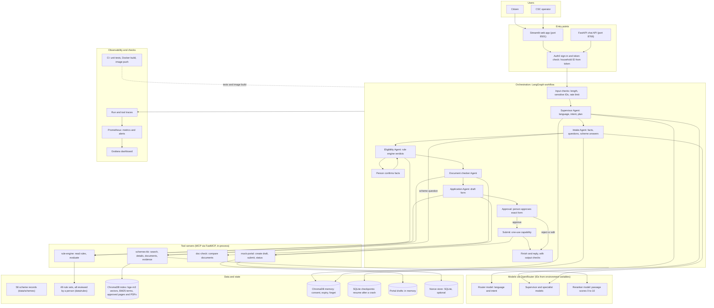

# Scheme Saathi: system architecture

This diagram is an original, implementation-oriented view of the Scheme Saathi
demo. Solid arrows show the example application journey; dotted arrows show
conditional or supporting connections. Not every request visits every box.
The numbered walkthrough below follows the same numbers.

Offline (not part of a conversation): ingestion builds the index from approved scheme pages and PDFs; a rule extractor drafts rules that a person must review; an evaluation harness runs the experiments.

## 3. Numbered walkthrough: one request

Example: "My mother is 62, a widow, lives in Pune, income Rs 2,50,000 a year. What can she get? Help me apply."

1. **Sign-in.** The user signs in through Auth0 in the web app. Every API call carries a token; the household ID comes from the token, never from the request body.
2. **Input checks (code).** The message is checked for length and for Aadhaar, bank or other ID numbers. Sensitive values are rejected or masked before any model sees them. The rate limit is 10 messages a minute.
3. **Language and intent (router model).** The router labels the language (Hindi here) and the intent (`eligibility` or `application`). If the model fails, a keyword fallback is used.
4. **Plan (supervisor model, then code).** The supervisor proposes the next desk. Code checks the reply's schema, and if a personal eligibility question was routed to scheme Q&A, it sends it to intake instead.
5. **Scheme shortlist and facts (intake).** Intake asks a model to pick up to five relevant schemes from the 49 reviewed ones. It reads the message into typed facts: age 62, widow, district Pune. Code validates each fact, converts amounts to the rule's period, and marks every fact as unconfirmed.
6. **Verdicts (rule engine, code).** For each shortlisted scheme the rule engine returns `eligible`, `not_eligible` or `cant_tell`, with the clause that decided it and any missing fields. No model is involved in the decision.
7. **One question at a time (intake).** If a verdict is still open, code picks the field that would settle the most open verdicts; the model only words the question, in the person's language. Intake stops after 12 questions or when the person declines.
8. **Confirmation.** The facts the verdicts rest on are shown to the person, who confirms, edits or rejects them. Edits re-run the rule engine.
9. **Documents (document checker).** For eligible schemes, the required-document list comes from the scheme record. The checker compares any uploaded document details with the profile. Missing items are computed by code; the model may add clarifying questions only.
10. **Draft (application).** The application agent builds the form from confirmed facts and creates a draft on the mock portal. The model writes a review summary; if that fails, a plain summary is used.
11. **Approval (human control).** The graph pauses. The person sees the exact form and its hash, then approves, edits or rejects. An edit or any change to the form invalidates an earlier approval.
12. **Submit (the only write).** Only after approval whose hash matches the form, the submit step gets a one-use capability (signed, 60-second expiry, bound to the household and the form) and calls the portal. Replays are refused by the nonce store.
13. **Reply and output checks.** The reply states each eligibility claim with its clause, says plainly what is unknown, and is written in the person's language. Claims without a rule-engine result are blocked.
14. **Memory (only with consent).** Confirmed facts and the application reference are saved with an expiry. A later "what happened to my application?" reads only this household's saved references. "Forget my data" deletes the household's stored values and documents.
15. **Trace and metrics.** Each run and tool call is traced, counted and timed. Prometheus rules alert on error rates, latency and lost traces; Grafana shows the dashboard.

Failure paths: a rejected or mismatched approval submits nothing; a tool error or exhausted budget returns a structured error, not a guess; an unanswerable scheme question returns "not found in the reviewed documents".

## 4. Brief requirements: status

| Brief requirement | Built on `develop` | Evidence and gap |
| --- | --- | --- |
| Input guardrails (mask IDs, check injection) | Yes | Red team: 16 sensitive-input cases, blocked with defences on. |
| Supervisor and planner | Yes | Plan is model-proposed, code-checked. Code routing table in `agents/supervisor.py` is not called by the live graph. |
| Intake agent with typed profile | Yes | Question choice is code. Evaluated in the gold set. |
| Eligibility analyst with rule engine | Yes | 49 of 49 rule sets reviewed. Verdicts fail closed. E4: rule engine 100% vs direct LLM 90.9% (held-out, 95 verdicts). |
| Document checker | Yes | Compares fields; no authenticity claims. |
| Application agent and approval gate | Yes | Approval bound to hash; edit invalidates. Portal drafts still in memory (restart loses them). |
| Output guardrails (clause citations) | Yes | Ungrounded eligibility claims are blocked by code. |
| Memory with consent, expiry, delete | Yes | Household-scoped; forget removes data. Memory evaluation is development-only (742 to 624 questions, no verdict changes). |
| Retrieval: multilingual embeddings, BM25, reranker, query rewrite, citations | Yes | Recall@5 0.917 to 1.000 on a 12-query set; one additional query. Not independently labelled. |
| MCP servers (schemes-kb, rule-engine, doc-check, mock-portal) with read or write marks | Yes | Read or write marks in `graph/tools.py`; only the application agent and the baseline may write. Servers run in-process, not as separate services. |
| LangGraph with typed state, conditional edges, self-correction loop, checkpointer | Yes | SQLite checkpointer; resume after stop is tested. |
| Planning with replan | Partial | Plan object exists; replan on contradicting tool results is limited to the reroute path. |
| Multi-agent team with single-agent baseline (E1) | Yes | C0, C1, C2 built. Held-out: C0 100%, C1 100%, C2 54.0%. Team did not justify its cost on this task. |
| Reflexion loop with frozen playbook (E3) | Yes | 12 lessons frozen before held-out. Held-out F1 0.880 to 0.868: lessons did not help. One rejected lesson with reason is documented. |
| Golden set 60+ with dev and held-out splits | Yes | 71 cases (21 development, 50 held-out). One labeller only. |
| Judge from a different model family, 20+ human labels, kappa | Partial | Preliminary: 20 of 20 agreement, kappa 1.0, but labels were revised after seeing judge output. Not independent. |
| Human control: interrupt, approve, edit, reject, pre- and post-tool hooks | Yes | Pre-tool permission and budget; post-tool audit logs. |
| Red-team suite of 30+ attacks, defences off and on (E2) | Yes | 96 attacks, 29 legitimate cases. Defences on: 5.2% attack success (5 misstatement attacks remain), 0% legitimate work blocked. Scam-page, injection and memory-isolation attacks included. Written by the same team that built the guards, except 19 added on 11 Nov. |
| Threat model, memory policy, tool list | Yes | `docs/threat-model.md`, `docs/memory-policy.md`, `docs/tool-list.md`. |
| FastAPI service with streaming | Yes | Streaming responses in `app/api.py`. |
| Docker Compose: app, MCP servers, vector store, Prometheus, Grafana | Partial | Compose starts the app, Prometheus and Grafana. MCP servers and the vector store run inside the app container, not as separate services. |
| Prompts and model IDs in one versioned config | Partial | Model IDs come from environment variables. Prompts are in code, not in a versioned config file. |
| CI runs tests and evaluation, fails below a threshold | Partial | CI runs unit tests and builds and pushes the image. No evaluation threshold gate in CI. |
| Grafana dashboard and one working alert | Yes | Dashboard JSON and Prometheus alert rules (run errors, latency, model and tool errors, lost traces). |
| Deliverables: README, diagram, walkthrough, evaluation report, experiment log, contribution log, slides, demo recording | Partial | Report, experiment log, contribution log and this walkthrough exist. Slides and the demo recording are not in the repository. |

## Supporting layers and boundaries

- **MCP tools and retrieval.** The graph calls in-process FastMCP servers through
  an allow-listed tool boundary with actor permissions, call budgets and
  metadata-only audit events. The knowledge base supports scheme details and
  evidence search; the rule engine decides eligibility independently of retrieved
  prose. See [tool inventory](tool-list.md) and
  [retrieval evaluation](retrieval-evaluation.md).
- **Memory and identity.** Long-term memory is optional and purpose-scoped.
  Consent, expiry, an allowlist and deletion controls apply; remembered facts
  must be confirmed again for a decision. Household identity comes from the
  authenticated session, not model output. See [memory policy](memory-policy.md).
- **Measurement and improvement are offline or optional.** Optional
  observability records operational metrics and traces; it does not decide the
  verdict. The evaluation harness measures system behaviour, while the
  rule-extraction improvement loop uses reviewed lessons and requires human
  review before rules go live. These are not steps executed for every citizen
  request. See [observability architecture](observability-architecture.md),
  [evaluation report](evaluation-report.md) and
  [experiment log](experiment-log.md).
- **Prototype limitations.** The portal is a mock, not a real submission
  integration; application records are process-local. Input/output guards and
  source-domain checks are imperfect, and an official-domain URL does not
  authenticate its content. A draft can be created before the human approval
  interrupt, so this implementation does not gate every write on that interrupt.
  See [threat model](threat-model.md) for the trust boundaries and remaining risks.

## Implementation references

- [Agent workflow and approval](../graph/agent_workflow.py)
- [MCP tool boundary](../graph/tools.py)
- [Rule-engine records and readiness](../servers/rule_engine/scheme.py)
- [Knowledge-base server](../servers/schemes_kb/server.py)
- [API](../app/api.py) and [Streamlit interface](../app/app_new.py)
- [Memory runtime](../app/memory_runtime.py) and
  [observability architecture](observability-architecture.md)
