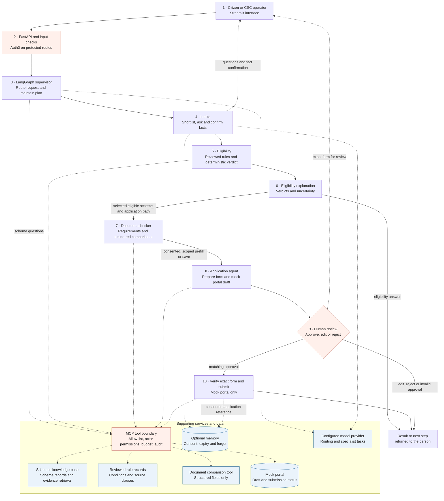

# Scheme Saathi: system architecture

This diagram is an original, implementation-oriented view of the Scheme Saathi
demo. Solid arrows show the example application journey; dotted arrows show
conditional or supporting connections. Not every request visits every box.
The numbered walkthrough below follows the same numbers.

## Numbered walkthrough: one application journey

Example: a family member asks for help finding a scheme and applying for it.
The facts below are illustrative, not a real person's data.

1. **Start in the interface.** A citizen or CSC operator sends a request in the
   Streamlit interface. The demo supports English, Hindi and Marathi, but
   language quality and consistency are not guaranteed.
2. **Check the request.** FastAPI receives the request. Protected routes use
   Auth0 identity and household scope; input checks reject recognized sensitive
   identifier patterns. The checks are heuristic, not a guarantee that every
   sensitive value or injection attempt is detected.
3. **Route and plan.** The supervisor and LangGraph workflow classify the
   request, maintain journey state and choose the next step. A general scheme
   question can instead go to evidence retrieval and a response; it does not
   automatically start an application.
4. **Collect and confirm facts.** Intake extracts typed candidate facts and
   shortlists schemes. While verdicts remain open, code selects a question
   intended to settle the most open verdicts; the interaction can stop at its
   question limit. If optional memory is enabled and consent permits it, it can
   prefill facts. The person reviews the facts at an `interrupt()`; final
   decisions use confirmed facts.
5. **Evaluate reviewed rules.** The graph calls the rule engine through the MCP
   boundary. Code—not the model—evaluates reviewed rules and returns `eligible`,
   `not_eligible` or `cant_tell`, with reasons, missing information and source
   clauses. A definite failed condition takes precedence over missing information.
   The workflow may evaluate earlier, unconfirmed facts to select questions;
   those interim results are not final advice.
6. **Explain the result.** The eligibility agent formats the rule-engine result;
   the supervisor checks specialist output when the workflow finishes. A scheme's
   recorded closed status can be included as a notice. A `cant_tell` or `not_eligible` result does not
   become permission to draft an application. Source pages and tool results are
   data, not instructions; their claims and availability may need rechecking.
7. **Check documents when applicable.** For the application path, the document
   checker compares the requirements and supplied document information.
   Structured comparisons can flag differences; they do not prove document
   authenticity or inspect the contents of uploaded files.
8. **Prepare the application.** For a selected scheme with an `eligible`
   rule-engine result, the application agent builds a form from confirmed facts.
   An incomplete form returns for more information. A complete form creates a
   **mock portal draft before** the approval pause; it is not yet a submission.
9. **Pause for a person.** The graph uses `interrupt()` to show the exact form
   and its payload hash. The person can approve, edit or reject it. Editing
   invalidates the approval; an invalid or rejected decision does not submit.
10. **Submit only the approved form.** The submit step checks that the current
    form, approved hash and portal draft match, then uses a bound capability to
    submit to the **mock portal**, not a government system. It returns a mock
    reference. With appropriate consent, an application reference may be saved
    for a later status request.

## Supporting layers and boundaries

- **MCP tools and retrieval.** The graph calls in-process FastMCP servers through
  an allow-listed tool boundary with actor permissions, call budgets and
  metadata-only audit events. The knowledge base supports scheme details and
  evidence search; the rule engine decides eligibility independently of retrieved
  prose. See [tool inventory](tool-list.md) and
  [retrieval evaluation](retrieval-evaluation.md).
- **Memory and identity.** Long-term memory is optional and purpose-scoped.
  Consent, expiry, an allowlist and deletion controls apply; remembered facts
  must be confirmed again for a decision. Household identity comes from the
  authenticated session, not model output. See [memory policy](memory-policy.md).
- **Measurement and improvement are offline or optional.** Optional
  observability records operational metrics and traces; it does not decide the
  verdict. The evaluation harness measures system behaviour, while the
  rule-extraction improvement loop uses reviewed lessons and requires human
  review before rules go live. These are not steps executed for every citizen
  request. See [observability architecture](observability-architecture.md),
  [evaluation report](evaluation-report.md) and
  [experiment log](experiment-log.md).
- **Prototype limitations.** The portal is a mock, not a real submission
  integration; application records are process-local. Input/output guards and
  source-domain checks are imperfect, and an official-domain URL does not
  authenticate its content. A draft can be created before the human approval
  interrupt, so this implementation does not gate every write on that interrupt.
  See [threat model](threat-model.md) for the trust boundaries and remaining risks.

## Implementation references

- [Agent workflow and approval](../graph/agent_workflow.py)
- [MCP tool boundary](../graph/tools.py)
- [Rule-engine records and readiness](../servers/rule_engine/scheme.py)
- [Knowledge-base server](../servers/schemes_kb/server.py)
- [API](../app/api.py) and [Streamlit interface](../app/app_new.py)
- [Memory runtime](../app/memory_runtime.py) and
  [observability architecture](observability-architecture.md)
