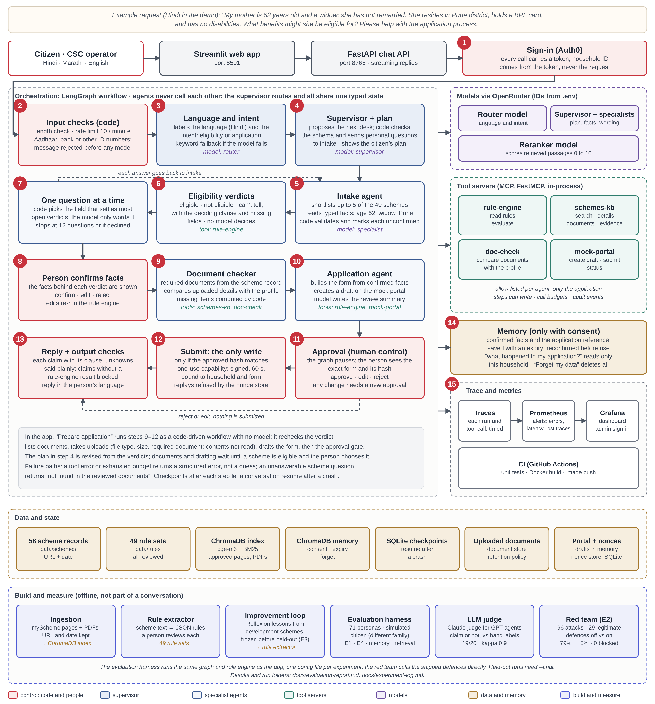
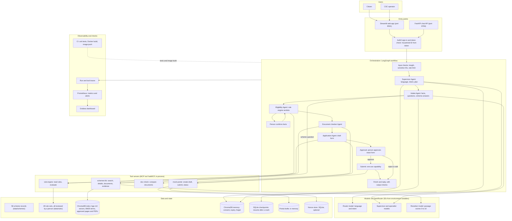

# Scheme Saathi: system architecture

This diagram is an original, implementation-oriented view of the Scheme Saathi
demo. Its numbers 1–15 match the walkthrough below; the band at the bottom is
the offline build-and-measure work (ingestion, rule extraction, Reflexion,
evaluation harness, LLM judge, red team). Not every request visits every box.

The LangGraph graph itself, generated from the code, is in [workflow-graph.md](workflow-graph.md).

The same architecture as a Mermaid diagram

Offline (not part of a conversation): ingestion builds the index from approved scheme pages and PDFs; a rule extractor drafts rules that a person must review; an evaluation harness runs the experiments.

## Numbered walkthrough: one request

Example (the demo request, asked in Hindi): "My mother is 62 years old and a widow; she has not remarried. She resides in Pune district, holds a BPL card, and has no disabilities. What benefits might she be eligible for? Please help with the application process."

1. **Sign-in.** The user signs in through Auth0 in the web app. Every API call carries a token; the household ID comes from the token, never from the request body.
2. **Input checks (code).** The message is checked for length and for Aadhaar, bank or other ID numbers. A message containing one is rejected before any model sees it. The rate limit is 10 messages a minute.
3. **Language and intent (router model).** The router labels the language (Hindi here) and the intent (`eligibility` or `application`). If the model fails, a keyword fallback is used.
4. **Plan (supervisor model, then code).** The supervisor proposes the next desk. Code checks the reply's schema, and if a personal eligibility question was routed to scheme Q&A, it sends it to intake instead. The citizen sees a plan (profile, schemes, rules, documents, draft) that the rule engine's verdicts revise; documents and drafting wait until a scheme is eligible and the person chooses it.
5. **Scheme shortlist and facts (intake).** Intake asks a model to pick up to five relevant schemes from the 49 reviewed ones. It reads the message into typed facts: age 62, widow, district Pune. Code validates each fact, converts amounts to the rule's period, and marks every fact as unconfirmed.
6. **Verdicts (rule engine, code).** For each shortlisted scheme the rule engine returns `eligible`, `not_eligible` or `cant_tell`, with the clause that decided it and any missing fields. No model is involved in the decision.
7. **One question at a time (intake).** If a verdict is still open, code picks the field that would settle the most open verdicts; the model only words the question, in the person's language. Intake stops after 12 questions or when the person declines.
8. **Confirmation.** The facts the verdicts rest on are shown to the person, who confirms, edits or rejects them. Edits re-run the rule engine.
In the app, "Prepare application" runs steps 9–12 as a code-driven workflow with no model (`graph/workflow.py`): it rechecks the verdict, lists the documents, takes uploads (checked for file type, size and required document; contents are not read), drafts the form and pauses at the approval gate.

9. **Documents (document checker).** For eligible schemes, the required-document list comes from the scheme record. The checker compares any uploaded document details with the profile. Missing items are computed by code; the model may add clarifying questions only.
10. **Draft (application).** The application agent builds the form from confirmed facts and creates a draft on the mock portal. The model writes a review summary; if that fails, a plain summary is used.
11. **Approval (human control).** The graph pauses. The person sees the exact form and its hash, then approves, edits or rejects. An edit or any change to the form invalidates an earlier approval.
12. **Submit (the only write).** Only after approval whose hash matches the form, the submit step gets a one-use capability (signed, 60-second expiry, bound to the household and the form) and calls the portal. Replays are refused by the nonce store.
13. **Reply and output checks.** The reply states each eligibility claim with its clause, says plainly what is unknown, and is written in the person's language. Claims without a rule-engine result are blocked.
14. **Memory (only with consent).** Confirmed facts and the application reference are saved with an expiry. A later "what happened to my application?" reads only this household's saved references. "Forget my data" deletes the household's stored values and documents.
15. **Trace and metrics.** Each run and tool call is traced, counted and timed. Prometheus rules alert on error rates, latency and lost traces; Grafana shows the dashboard.

Failure paths: a rejected or mismatched approval submits nothing; a tool error or exhausted budget returns a structured error, not a guess; an unanswerable scheme question returns "not found in the reviewed documents".

## Supporting layers and boundaries

- **MCP tools and retrieval.** The graph calls in-process FastMCP servers through
  an allow-listed tool boundary with actor permissions, call budgets and
  metadata-only audit events. The knowledge base supports scheme details and
  evidence search; the rule engine decides eligibility independently of retrieved
  prose. See [tool inventory](tool-list.md) and
  [retrieval evaluation](retrieval-evaluation.md).
- **Memory and identity.** Long-term memory is optional and purpose-scoped.
  Consent, expiry, an allowlist and deletion controls apply; remembered facts
  must be confirmed again for a decision. Household identity comes from the
  authenticated session, not model output. See [memory policy](memory-policy.md).
- **Measurement and improvement are offline or optional.** Optional
  observability records operational metrics and traces; it does not decide the
  verdict. The evaluation harness measures system behaviour, while the
  rule-extraction improvement loop uses reviewed lessons and requires human
  review before rules go live. These are not steps executed for every citizen
  request. See [observability architecture](observability-architecture.md),
  [evaluation report](evaluation-report.md) and
  [experiment log](experiment-log.md).
- **Prototype limitations.** The portal is a mock, not a real submission
  integration; application records are process-local. Input/output guards and
  source-domain checks are imperfect, and an official-domain URL does not
  authenticate its content. A draft can be created before the human approval
  interrupt, so this implementation does not gate every write on that interrupt.
  See [threat model](threat-model.md) for the trust boundaries and remaining risks.

## Implementation references

- [Agent workflow and approval](../graph/agent_workflow.py)
- [MCP tool boundary](../graph/tools.py)
- [Rule-engine records and readiness](../servers/rule_engine/scheme.py)
- [Knowledge-base server](../servers/schemes_kb/server.py)
- [API](../app/api.py) and [Streamlit interface](../app/app_new.py)
- [Memory runtime](../app/memory_runtime.py) and
  [observability architecture](observability-architecture.md)
