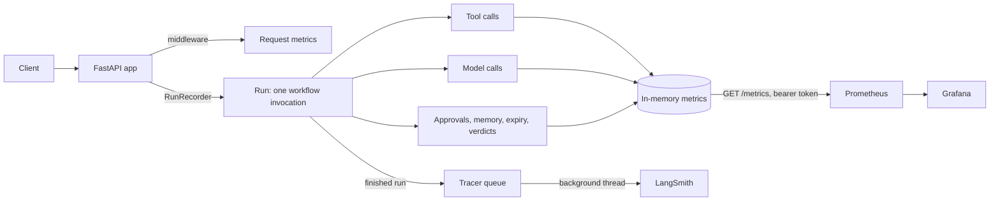

# Observability: how it works and what is traced

This explains the design: what is recorded, where, and in what order. For setup, every metric and ready-made
queries, see [observability.md](./observability.md).

Everything here runs only when `OBSERVABILITY_ENABLED=true`. With it off, each hook does nothing and the app
behaves as before.

## Overview

## The flow, in order

1. **Start-up.** `create_api()` in [app/api.py](../app/api.py) calls `install_observability()`. When it is on, this
   switches recording on, adds the request middleware and the protected `/metrics` route, and starts the tracing
   backend if `TRACING_BACKEND` names one. `scheme_saathi_build_info` reports which.
2. **Every HTTP request** passes through the middleware ([observability/http.py](../observability/http.py)). It records
   the method, the route template (never the real path), the status class and the duration. A streamed response is
   timed to its end.
3. **A workflow request starts a run.** The five run endpoints each create a `RunRecorder`
   ([observability/runs.py](../observability/runs.py)), which starts a timer and a running total:

   | Run `kind` | Endpoint |
   |---|---|
   | `chat_turn` | `POST /api/chat` |
   | `chat_decision` | `POST /api/chat/{id}/decision` |
   | `application_start` | `POST /api/analyze` |
   | `application_decision` | `POST /api/threads/{id}/decision` |
   | `legacy_chat` | `POST /api/chat/legacy` |

4. **While the run executes**, code that already existed reports what it does through small hooks:
   - **Tool calls.** `graph/tools.py` reports every call to the rule engine, schemes knowledge base, document checker
     and mock portal.
   - **Model calls.** A LangChain callback attached in `agents/model_factory.py` reports the supervisor and
     specialist models. The router calls OpenRouter directly, so `agents/supervisor.py` reports it by hand.
   - **Approvals.** `graph/tools.py` reports each approval decision.
   - **Memory.** `graph/agent_workflow.py` and `app/memory_api.py` report loads, saves, references, consent and forget.
   - **Expiry.** `app/api.py` and `app/business_logic.py` report threads and sessions that expired.

   Each tool and model call is added to the current run's totals. When tracing is on, it is also kept as a span.
   The run is found through a context variable, so calls made in worker threads still reach it.
5. **The run finishes** once, with one outcome. A streamed run finishes with its last event. A stream the client
   abandons finishes as `cancelled`, or with the outcome it had already reported. At that point the run:
   - records its duration, outcome and error class (server-side failures only);
   - records its tool calls, model calls, tokens, cost and unpriced calls;
   - counts its eligibility verdicts and any guardrail block;
   - hands one finished trace to the tracer.
6. **Tracing.** The tracer decides whether to keep the run, using `TRACING_SAMPLE_RATE`. A run that failed on the
   server side is always kept. A kept run goes on a queue of 200, and a background thread sends it to LangSmith. If
   the queue is full the trace is dropped. Either way it is counted in `scheme_saathi_traces_total`, and the
   request is never delayed.
7. **Prometheus** scrapes `GET /metrics` with the bearer token. Recording rules precompute error ratios,
   percentiles and spend. Alert rules flag problems. Grafana reads from Prometheus.

## What is recorded

| Source | What | Metrics | Trace |
|---|---|---|---|
| Every request | count, latency, status, unhandled exceptions by class name | yes | no |
| Each run | outcome, duration, runs in progress, server-side errors, time to first streamed event | yes | root span |
| A run's totals | tool calls, model calls, tokens in and out, cost, unpriced calls | yes | root span metadata |
| Each model call | role, model, latency, tokens, cost, error class | yes | `llm` span |
| Each tool call | server, tool, outcome, latency, error code | yes | `tool` span |
| Eligibility verdicts | `eligible`, `not_eligible`, `cant_tell`, with no scheme label | yes | no |
| Approvals | action and result | yes | no |
| Guardrail blocks | input or output | yes | no |
| Memory operations | operation and result | yes | no |
| Thread expiry | kind and reason | yes | no |
| Tracing health | exported, sampled out, dropped, failed | yes | no |

### Model cost

Cost comes from the provider when it reports one (OpenRouter is asked to, while observability is on). Otherwise it is
tokens times the price in [observability/model_prices.json](../observability/model_prices.json), which ships empty. A
successful call with neither is counted as **unpriced**, never as free, so spend is never silently understated.
A failed call has no cost.

## What a LangSmith trace contains

- **Root span**, named `scheme-saathi <kind>`. Its metadata holds the run kind, outcome, duration, tool and model
  counts, tokens, cost, error class if any, and `thread_id`, which is a salted hash of the thread ID.
- **One child span per model call and per tool call.** An `llm` span carries the model name and token usage. A `tool`
  span carries the server, tool and outcome.
- At most 200 spans per trace. The root records how many were dropped.

## What is deliberately not recorded

- Prompts, replies, tool arguments, fact values and error messages.
- Household, thread or application IDs, and any other personal data.
- Any output except token usage. The LangSmith client is built to drop every other input and output, so a mistake
  elsewhere cannot send content.

Metric labels come from a fixed allowlist, and each value is checked against a closed set or cleaned (see
[observability.md](./observability.md#hardening)). Failures are recorded by exception class name only. Leave
`LANGSMITH_TRACING` and `LANGCHAIN_TRACING_V2` unset: LangChain's own tracing would send full prompts to LangSmith.
The app warns at start-up if either is on.

## What is not traced

- **Memory, approvals, guardrails and verdicts** are metrics only. They are not spans.
- **Endpoints that are not runs** (`/health`, memory consent, forget, document upload) get request metrics only.
- **`graph/baseline.py` and the evaluation scripts** are not instrumented.
- **Model calls made inside a tool server**, such as the knowledge-base reranker, always count in the model metrics.
  They join the run's totals and trace only if the run context reaches that thread. It does on the normal synchronous
  path. The case where the caller already has a running event loop has not been verified.
- **Langfuse** is not implemented. `TRACING_BACKEND` accepts `none` or `langsmith`.

## Where the code lives

| Area | Files |
|---|---|
| Metrics and label allowlist | [observability/metrics.py](../observability/metrics.py) |
| Runs, outcomes, per-run totals | [observability/runs.py](../observability/runs.py) |
| Hooks and closed label sets | [observability/hooks.py](../observability/hooks.py) |
| Model calls, cost, pricing | [observability/llm.py](../observability/llm.py), [observability/langchain_callbacks.py](../observability/langchain_callbacks.py), [observability/pricing.py](../observability/pricing.py) |
| LangSmith tracer | [observability/tracing.py](../observability/tracing.py) |
| Middleware and `/metrics` | [observability/http.py](../observability/http.py) |
| Settings | [observability/config.py](../observability/config.py) |
| Prometheus, Grafana, Compose | [observability/deploy/](../observability/deploy) |
| Hook points in existing code | `app/api.py`, `app/business_logic.py`, `app/memory_api.py`, `graph/tools.py`, `graph/agent_workflow.py`, `agents/model_factory.py`, `agents/supervisor.py` |

## Settings

All are in `.env` (see `.env.example`):

| Setting | Effect |
|---|---|
| `OBSERVABILITY_ENABLED` | Turns everything on. Off by default. |
| `METRICS_BEARER_TOKEN` | Required to read `/metrics`. Without it the endpoint refuses everyone. |
| `TRACING_BACKEND` | `none` (default) or `langsmith`. |
| `LANGSMITH_API_KEY`, `LANGSMITH_PROJECT`, `LANGSMITH_ENDPOINT` | LangSmith account, project and endpoint. |
| `TRACING_SAMPLE_RATE` | Share of runs traced, 0 to 1. Failed runs are always traced. |
| `TRACING_HASH_SALT` | Keeps the hashed thread ID stable across restarts. |
| `MODEL_PRICES_FILE` | A price file to use instead of the shipped one. |
