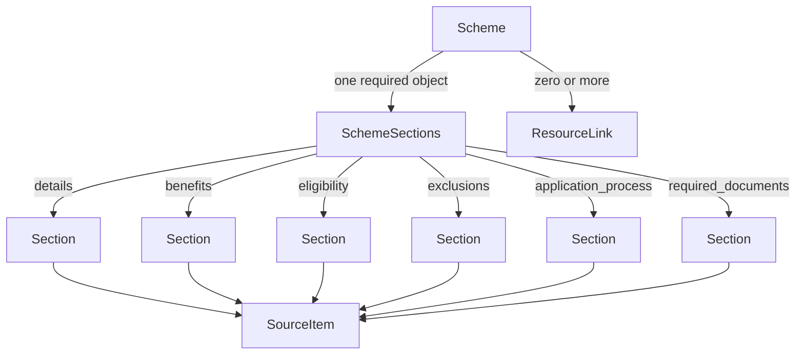

# Scheme data relationships

This document describes the current Python models, so team members can review the data structure before we add storage and retrieval.

- Model definitions: [models.py](../servers/schemes_kb/models.py)
- Full C11 record: [sui.json](../data/schemes/sui.json)

## Relationship overview



Each Section contains zero or more SourceItems. The single SourceItem box represents a shared model type; it does not mean sections share the same passage instance.

If your Markdown viewer does not render Mermaid, the same structure is:

```text
Scheme
├── scheme_id, slug, name, government_level, geography
├── source_url, collected_on
├── review_status, availability_status, sample_only
├── sections: SchemeSections (exactly one)
│   ├── details: Section
│   ├── benefits: Section
│   ├── eligibility: Section
│   ├── exclusions: Section
│   ├── application_process: Section
│   └── required_documents: Section
│       Each Section:
│       ├── capture_status
│       └── items: SourceItem[] (zero or more)
│           ├── text
│           ├── source_url
│           ├── source_path
│           ├── channel (optional)
│           └── heading (optional)
└── links: ResourceLink[] (zero or more)
    ├── title, type
    ├── url, source_url
    ├── format
    └── verification_status
```

These are nested JSON/Python relationships. We have not created database tables or foreign keys.

## Model responsibilities

| Model | Purpose | Relationship |
|---|---|---|
| Record | Shared validation setting: reject undeclared fields. | All our data models inherit from it; it is not a separate stored record. |
| Scheme | Scheme identity, collection information, status, sections and resource links. | Contains one SchemeSections object and zero or more ResourceLinks. |
| SchemeSections | Requires all six named sections. | Each named field contains one Section. |
| Section | Collection status and original source passages. | Contains zero or more SourceItems. |
| SourceItem | One passage and its source location/context. | Nested inside a Section; no standalone ID yet. |
| ResourceLink | A form, application portal, guideline or other resource. | Nested in Scheme.links; no standalone ID yet. |

## Following one eligibility passage

The C11 record's third eligibility item is accessed in Python as:

```python
scheme.sections.eligibility.items[2].text
```

Python list positions start at zero, so `[2]` selects the third item. Load the record first:

```python
from pathlib import Path
from servers.schemes_kb.models import Scheme

scheme = Scheme.model_validate_json(
    Path("data/schemes/sui.json").read_text(encoding="utf-8")
)
```

Run from the project root.

Its source references are:

```python
scheme.sections.eligibility.items[2].source_url
scheme.sections.eligibility.items[2].source_path
```

`source_url` identifies the source page. `source_path` locates the passage within the collected source JSON; it is not a second URL or a filesystem path. Source snapshots and stable passage IDs will be added later so references remain reproducible when source pages change.

## Status fields have different meanings

| Field | Allowed values | Meaning |
|---|---|---|
| Section.capture_status | captured, partial, not_in_source, not_collected | How much of that section we collected from the inspected source. |
| Scheme.review_status | draft, needs_correction, approved | Whether the scheme record has been reviewed. |
| Scheme.availability_status | unverified, open, closed | Whether applications are currently available. |
| ResourceLink.verification_status | pending, checked, broken | Whether the destination link has been checked. |

A captured section is not automatically verified. An absent exclusions section is not evidence that no exclusions apply. Checking a link does not approve its contents. The collection date is not the scheme's effective date.

The full C11 record is approved and open (availability rechecked on 1 November 2026). The sample_only flag remains available to exclude any future teaching fixtures from indexing; the original teaching sample has been removed. Source-record approval does not constitute an executable eligibility decision.

## Resource links and required documents

`required_documents` describes evidence an applicant must supply. `links` describes resources someone can open, such as a form or guidelines PDF.

An application form download may be relevant to an application instruction, but the current model does not link individual instructions to ResourceLinks. We have not added link IDs or `link_ids` references yet. Similarly, storing a PDF URL does not download or index its contents.

## Validation we have today

Pydantic checks the nested structure, field types, allowed status values, HTTP/HTTPS URL syntax, dates, and the declared minimum lengths. It rejects unknown fields.

It does not currently enforce:

- Unique scheme IDs across files.
- Consistency between capture_status and the number of items.
- Reviewer identity or evidence before setting approved.
- Whether a URL is reachable or genuinely belongs to an official provider.
- Whether scheme information is accurate, complete or currently applicable.
- Whitespace-only text, which still satisfies a minimum length of one.

## Planned additions, not implemented

We will add these in small steps after reviewing this structure:

1. Document records with document_id, scheme_id, original file location, source URL, file hash and processing status.
2. Page-aware extracted passages and stable passage IDs.
3. Chunks with chunk_id, source references, page ranges, section context and previous/next links where appropriate. Start with about 300 model tokens and 50-token overlap, then evaluate.
4. ChromaDB records containing embeddings, chunk text and filterable metadata. Keep the original structured records outside the vector index.
5. Structured application routes, ordered steps, conditional document requirements and reviewed eligibility rules.

Overlap helps retain nearby context. It does not replace complete reviewed rules: retrieval relevance alone must not determine eligibility.

## Team review

Please review whether the six sections cover your sources, whether collection statuses are understandable, and which schemes need conditional rules or multiple application routes. Record examples before expanding the models.
