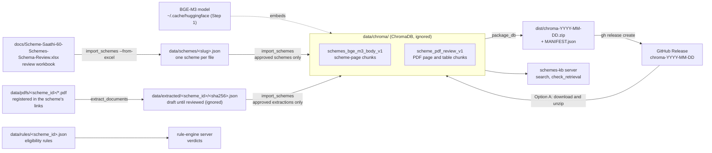
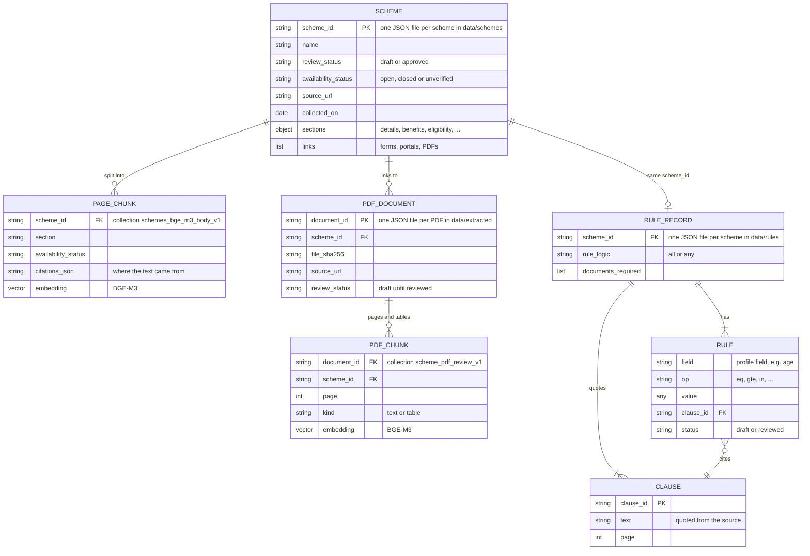

# Setup, scheme data and running the app

*Moved from the README. The README has the short version; this is the full setup, how the scheme data is built and published, and how to run and use the app.*

## Setup

Use Python 3.12 (the project requires Python 3.11 or newer). Run all commands from the project root.

Create and activate a virtual environment:

```bash
python3.12 -m venv .venv
source .venv/bin/activate
python --version
```

On Windows, activate with `.venv\Scripts\activate` instead. On macOS with Homebrew, if `python3.12` is unavailable, use `"$(brew --prefix python@3.12)/bin/python3.12"` to create the environment. An existing environment created with Python 3.9 must be replaced or a new environment folder used.

Install the project and all currently declared dependencies:

```bash
python -m pip install --upgrade pip
python -m pip install -r requirements.txt
```

`requirements.txt` installs the project in editable mode with its `dev` and `rag` extras, so this one command installs everything: the application code (Pydantic, LangGraph, LangChain), Pytest, and the RAG stack (ChromaDB, Sentence Transformers, PyTorch, pypdf, pdfplumber, openpyxl). Dependency declarations stay in `pyproject.toml`, so there is one list to maintain. PyTorch needs substantial disk space. These are version ranges rather than a frozen environment. If you created your environment before a dependency was added, rerun the install command.

- Pydantic and LangGraph for the current application code.
- Pytest for tests.

Scheme search uses a ChromaDB database in `data/chroma/`. It is ignored by Git, so each teammate needs a copy. There are two ways to get one:

- **Option A, download the shared database (recommended):** about 4 MB, ready in a minute, no import needed.
- **Option B, build it yourself:** needed only if you change scheme data and want to search the change before a new release exists.

### How the data fits together

Where each piece of data lives and which command moves it. Folders marked "ignored" are not in Git.



The records and how they connect. Everything joins on `scheme_id`; these are JSON files and ChromaDB metadata, not database tables with foreign keys.



The scheme record format is defined in `servers/schemes_kb/models.py`. Only rule records whose rules are all `reviewed` give live verdicts; those are the records in `data/rules/`. The synthetic `SYNTH-PENSION-001` is a test-only fixture in `tests/fixtures/`, loaded by `tests/conftest.py`; users never see it.

### Step 1: Download the embedding model (once per machine)

Vector and hybrid search turn your question into numbers with the BGE-M3 model, which runs on your computer. Download it once:

```bash
python -m servers.schemes_kb.embedding_demo
```

This needs internet access and about 2.3 GB of disk space. The model is cached in `~/.cache/huggingface/`, and other scripts reuse it offline. It does not need an OpenRouter key.

You can skip this step if you only use keyword search (`--method bm25`), which works with the database alone.

### Step 2, Option A: Download the shared database

The database is published as a zip on the [GitHub Releases page](https://github.com/scheme-saathi/scheme-saathi/releases). Each release is tagged `chroma-YYYY-MM-DD`; use the newest one.

With the GitHub CLI (`gh`, installed and logged in with `gh auth login`):

```bash
# 1. Move any old database aside (unzipping over it would mix two databases).
[ -d data/chroma ] && mv data/chroma "data/chroma.old-$(date +%Y%m%d)"

# 2. Find the newest database release and download its zip into dist/.
TAG=$(gh release list --repo scheme-saathi/scheme-saathi --limit 100 --json tagName \
  --jq '[.[].tagName | select(startswith("chroma-"))] | sort | last')
echo "Downloading $TAG"
gh release download "$TAG" --repo scheme-saathi/scheme-saathi --pattern "$TAG.zip" --dir dist --clobber

# 3. Unzip it. This creates data/chroma/.
unzip "dist/$TAG.zip" -d data/

# 4. Check what you downloaded.
cat data/chroma/MANIFEST.json
```

Without `gh`: open the Releases page in a browser, download the `chroma-YYYY-MM-DD.zip` asset from the newest `chroma-` release, move any existing `data/chroma` folder aside, and extract the zip into `data/`. On Windows (PowerShell), extract with `tar -xf chroma-YYYY-MM-DD.zip -C data`.

`MANIFEST.json` records the release date, the Git commit the database was built from, the embedding model, the ChromaDB version and the record counts. Your `chromadb` package must be the same major version (1.x), which `requirements.txt` already ensures. The shared database contains approved records only: no draft review collection and no draft PDF chunks.

When a new database release is announced, repeat steps 1 to 4. Delete old `data/chroma.old-*` folders once the new copy works.

### Step 2, Option B: Build the database yourself

```bash
python -m servers.schemes_kb.import_schemes
```

This reads the approved records in `data/schemes/`, embeds them with BGE-M3 (about 1 to 2 minutes on a laptop CPU) and writes `data/chroma/`. Rerun it whenever you change scheme JSON files. To also inspect draft schemes in a separate review collection:

```bash
python -m servers.schemes_kb.import_schemes --review
python -m servers.schemes_kb.test_retrieval --review
```

### Step 3: Search and check

```bash
# Keyword search (no model needed)
python -m servers.schemes_kb.search --method bm25 --question "loan to start a small business"

# Hybrid search (keyword + vector; needs the model from step 1)
python -m servers.schemes_kb.search --method hybrid --question "loan to start a small business"

# Only schemes currently open for applications
python -m servers.schemes_kb.search --method hybrid --availability open --question "pension for elderly"

# Rerank the top 20 hybrid candidates with SPECIALIST_MODEL (needs the .env model settings; ~3s per query)
python -m servers.schemes_kb.search --method hybrid --rerank --question "age limit to join Atal Pension Yojana"

# Pass/fail smoke check across all approved schemes
python -m servers.schemes_kb.check_retrieval
```

If you see `Database not found`, step 2 was skipped or the zip was extracted to the wrong folder; `data/chroma/chroma.sqlite3` must exist. If you see an error about cached model files, run step 1. Closed schemes are kept for reference; use `--availability open` to leave them out.

### Publishing a new database release (maintainers)

Publish a new release whenever approved scheme data changes, so teammates don't have to re-import.

1. Commit the scheme data changes (`data/schemes/`, and the review workbook if it changed). The packaging script refuses to run while `data/schemes/` has uncommitted changes, so the release always matches a commit.
2. Rebuild your local database from the committed data:

   ```bash
   python -m servers.schemes_kb.import_schemes
   ```

3. Package it. This copies only approved records into a fresh database, adds `MANIFEST.json`, writes `dist/chroma-YYYY-MM-DD.zip`, and reopens the zip to check it:

   ```bash
   python -m servers.schemes_kb.package_db
   ```

4. Push the commit, then publish the zip as a GitHub Release (needs release permission on the repository):

   ```bash
   gh release create chroma-YYYY-MM-DD dist/chroma-YYYY-MM-DD.zip \
     --repo scheme-saathi/scheme-saathi --target develop \
     --title "Scheme database YYYY-MM-DD" \
     --notes "Approved scheme database built from commit <git_commit in MANIFEST.json>. Download and extract into data/ (see README: Scheme search database)."
   ```

5. Tell the team the new tag so they can repeat Option A.

The repository is public, so release assets can be downloaded by anyone. Only publish approved data from public sources.

### Updating scheme availability

`availability_status` records whether applications are open (`open`), closed (`closed`) or not yet checked (`unverified`). It is separate from `review_status`, which records whether the scheme's content was reviewed. To update availability:

1. Check the scheme's official page (`source_url` in its JSON file) for an active apply option or a stated deadline.
2. Change `availability_status` in `data/schemes/<slug>.json`, and set the matching "Application availability" cell in the "Scheme review" sheet of `docs/Scheme-Saathi-60-Schemes-Schema-Review.xlsx` (`Available`, `Closed` or `Not verified`). Keep both in step, because `import_schemes --from-excel` regenerates the JSON from the workbook.
3. Follow the maintainer steps above. ChromaDB stores availability at import time, so the `--availability` filter only sees the change after a re-import.

Never mark a scheme `open` without checking; unknown availability stays `unverified`.

For later OpenRouter-backed agents, copy `.env.example` to `.env` and add your key. Never commit `.env`.
The local API/UI entry point is described below, along with Docker setup.

## Run with Docker

Build the image from the project root:

```bash
docker build -t scheme-saathi .
```

The approved ChromaDB database in `data/chroma` is included in the image. Run
the UI on <http://localhost:8501>. Provide your local `.env` file at runtime;
it is not copied into the image. Uploaded documents are stored in a named
Docker volume:

```bash
docker run --rm -p 8501:8501 --env-file .env -v scheme-saathi-documents:/app/data/private_documents scheme-saathi
```

Create `.env` from `.env.example` and configure the required model variables
before starting the container.

For building the image with or without the database and the embedding model, see [docker-deployment-guide.md](docker-deployment-guide.md).

## Run the app (Streamlit)

Start the Scheme Saathi interface from the project root:

```bash
streamlit run app/app_new.py
```

The UI starts a local FastAPI service on `127.0.0.1:8766` (`SCHEME_SAATHI_CHAT_API_PORT`) and consumes its
server-sent event stream while the eligibility workflow runs. Eligibility comes from the reviewed rules of 49 schemes;
results are not official benefit decisions. Applications are only submitted by the
mock workflow after the user approves the exact drafted form.

During chat, **Details collected so far** shows the unconfirmed profile. After
intake, ask the citizen to confirm the displayed details; **Change details in
chat** returns to the conversation without confirming them. Once the
reviewed rules return final results, select an eligible scheme and choose
**Prepare selected application** to proceed to documents and draft review.
On the Documents screen, select the requested redacted PDF, PNG or JPEG,
confirm the masking notice for each document, and select **Upload document**.
Alternatively, attach the next required document using the chat paperclip.
The workflow advances to review once all required documents are uploaded.
On the review screen, **Edit** updates collected profile details. Saving changes
rechecks eligibility and requires approval of the new draft.
If intake stops before confirmation, **Review preliminary results** shows
the current rule results without enabling application preparation; return to
chat to supply or correct details. Nothing is sent to a government portal.

The portal header shows the signed-in account and provides **New chat**,
**Saved details**, **Privacy & consent**, and **Sign out**. On smaller screens
these are in the account menu. **Saved details** opens what is remembered, the
saved and family applications, and "Forget my data". Opening the privacy notice
does not withdraw consent; withdrawal, starting a new chat, and signing out
require confirmation before clearing the active conversation and deleting the
active application with its saved details and uploaded documents. Sign out
clears the app session but does not explicitly end the Auth0 session.

Mock submission requires `MOCK_PORTAL_AUTH_SECRET` in the API environment.
If it is missing, approval is blocked without consuming the pending decision.
If submission fails after approval, its outcome may be unknown; check the mock
portal before preparing another application.

The approval and rejection button colors are set by `approvedButtonColor` and
`rejectButtonColor` in `.streamlit/scheme_saathi.toml`; Streamlit's standard
`config.toml` does not support per-button theme colors.

The API can also be run separately with
`uvicorn app.api:create_api --factory --host 127.0.0.1 --port 8766`. It exposes
`POST /api/analyze` and `POST /api/threads/{thread_id}/decision` as streaming
endpoints, plus `GET /health`.

## RAG commands and storage

```bash
python -m servers.schemes_kb.preview_chunks
python -m servers.schemes_kb.preview_embeddings --question "What documents are required?"
python -m servers.schemes_kb.test_retrieval --scheme-id C07 --question "Who can apply?" --top-k 3
python -m servers.schemes_kb.test_retrieval --availability open --question "Support for a new business"
```

The preview scripts generate ignored JSON outputs under `docs/`. The current chunker targets 300 body-text tokens with 50-token overlap and retains source references. It prefers source-passage endings but may split long passages; missing governing headings are not automatically inferred. Only chunk bodies are embedded; context prefixes are a planned improvement.

The approved collection is `schemes_bge_m3_body_v1`; `--review` selects `schemes_bge_m3_body_v1_review` and includes drafts. Both use local BGE-M3 vectors with cosine distance. Citations and context lists are stored as JSON strings in metadata. Full source sections remain in scheme JSON for complete document checklists and application instructions.

Reimporting updates matching IDs and removes obsolete chunks from that importer's collection, including withdrawn or deleted records. Keep one importer running at a time. Multi-batch importing is not atomic; rerun successfully after a failure before serving results. Use a separate collection if the model or embedding strategy changes.

Retrieval prints matching passages and citations; it does not generate answers or determine eligibility (cited answers come from the agent workflow; see [agents.md](agents.md)). Similarity scores are not probabilities, and nearest matches may still be irrelevant. BM25, RRF hybrid and optional LLM reranking are available. Contextual-prefix improvements remain pending.

## PDF and hybrid retrieval

Install updated dependencies with `python -m pip install -r requirements.txt`.

```bash
python -m servers.schemes_kb.extract_documents --scheme-id C09 --file "/path/to/guidelines.pdf" --source-url "https://official-source.example/guidelines.pdf"
```

Replace the example file path and source URL with the actual official document. This command accepts a local PDF and does not download its URL. It saves the original under ignored data/raw/ and draft page/table extraction under ignored data/extracted/. Ruled tables preserve merged cells, bounding boxes and HTML; scanned/borderless content still needs review. Repeat with --reextract to back up and replace an extraction. No extraction is automatically approved or published to the scheme index.

```bash
python -m servers.schemes_kb.test_pdf_retrieval --document "data/extracted/C09/<file-hash>.json"
python -m servers.schemes_kb.search --method hybrid --scheme-id C09 --question "What is the manpower cost limit?" --include-review-pdfs
```

Replace <file-hash> with the extraction filename. The PDF test indexes the selected extraction into scheme_pdf_review_v1. Combined search reuses stored records without reingestion, supports vector/bm25/hybrid methods, and returns source references. Draft PDF evidence is excluded unless --include-review-pdfs is explicit. --availability open filters out closed schemes in every method. Scores are ranking signals, not eligibility verdicts.

BM25 uses local frequency/length scoring (k1=1.2, b=0.75) over the same filtered passages, with Unicode-aware tokenization and HTML tags excluded. It does not call an LLM. Hindi keywords may not match English sources. Hybrid fuses up to 20 candidates per method using reciprocal rank fusion with constant 60. The original scheme-page and PDF collections remain separate. Overlap deduplication is not implemented.

`--rerank` (or `search_schemes(..., rerank=True)`) sends the first-stage top `candidate_k` passages (default 20, each cut to 1,500 characters, tables as visible text) to `SPECIALIST_MODEL` in one call. The model scores each 0 to 10; results are sorted by that score, with ties keeping first-stage order. Passage text is sent as untrusted data. If the call fails, the first-stage order is returned with a warning. Rerank scores are not comparable with vector, BM25 or RRF scores. The reranker can only reorder candidates the first stage found.

RAG scripts recognize synthetic:// rule fixtures and skip them without altering the rule-engine files. Malformed real scheme records still fail validation.

## Bulk scheme and PDF import

Save each PDF under `data/pdfs/<scheme_id>/`, for example
`data/pdfs/C09/guidelines.pdf`. In that scheme's existing `links` list,
add `"local_file": "data/pdfs/C09/guidelines.pdf"` to the corresponding
resource link. Keep its official `url`, title and other required link fields.
Every PDF in an approved scheme's folder must have a matching link.
PDFs and extraction output are local and ignored by Git; teammates must copy
these files separately if they need to rebuild the PDF index.

Run the existing command for all approved schemes and their registered PDFs:

```bash
python -m servers.schemes_kb.import_schemes
```

The first run extracts new PDFs into `data/extracted/<scheme_id>/<sha256>.json`
and prints pending review paths. Review prose, tables and page references against
the PDF, resolve any OCR flags, then set that extraction's `review_status` to
`approved`. Scheme approval alone does not approve a PDF. Run the same command
again to index approved PDFs together with scheme-page chunks. Table review
HTML is saved alongside the extraction. Large tables exceeding the embedding
model input limit stop the import rather than being silently truncated.

Imports use batched upserts with stable IDs. Repeated runs do not add duplicates.
The page collection mirrors selected scheme records; the PDF collection mirrors
registered, approved PDFs of approved schemes, removing obsolete approved chunks.
Draft PDF records created by the existing review script remain review-only.
Replacing a PDF changes its hash and requires a fresh review. `--review` continues
to import scheme-page drafts separately and does not run bulk PDF import.
Run only one importer at a time. Import is not transactional across collections;
if interrupted, rerun the command. No PDF is downloaded automatically.

Scheme reference links are stored in `Scheme.links` with their original titles, URLs,
and myScheme source paths. Paths containing `references[` identify the Sources and
References section. The importer stores `links_json` and `references_json` as Chroma
metadata; search results expose `links` and `references`. Re-run the importer after
link changes. Older indexed chunks return empty link lists until re-imported.
These linked resources are navigation links, not evidence that their contents were
downloaded, reviewed, or embedded. Local PDF paths are excluded from search output.

For this dataset, myScheme is the selected content source. Preserve its published
text and collection date; describe information as published on myScheme rather
than guaranteeing current policy. Known source discrepancies remain review notes.

Convert the approved review workbook to JSON without changing ChromaDB:

```bash
pip install -e '.[rag]'
python -m servers.schemes_kb.import_schemes --from-excel --export-only
```

Use `--from-excel /path/to/review.xlsx` for another workbook with the same tabs and
headers. Conversion validates every selected scheme before writing any JSON. It
joins continuation parts in order, rejects missing parts or unapproved related
rows, and keeps reference titles and URLs. Details, benefits, eligibility and
exclusions come from Source passages; application steps and applicant-document
text come from their review tabs. Eligibility rows provide an approval gate;
edit source wording in Source passages and re-review related rows together.
Existing local PDF paths are retained for matching link URLs. Link capture
approval does not mark the destination as checked. Existing JSON files absent
from the workbook are not automatically deleted.

After reviewing the exported files, import them with the normal command:

```bash
python -m servers.schemes_kb.import_schemes
```

Omitting `--export-only` combines Excel conversion and the database import in one
command. Export-only does not load the embedding model or open ChromaDB.
