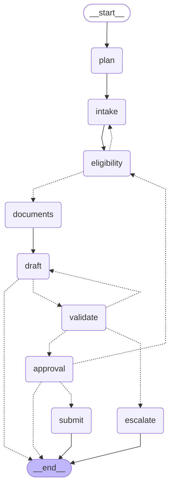

# Workflow graph

Generated from `graph/workflow.py` by `python -m graph.diagram --write`; do not edit by hand.
Dashed arrows are conditional edges.

- `validate` is the self-correction check: a failed draft returns to `draft` (at most 3 attempts), then goes to `escalate` for a person.
- `approval` pauses with `interrupt()`. Approve must carry the hash of the exact form; edit re-runs `eligibility` and needs a new approval; anything else ends the run.

