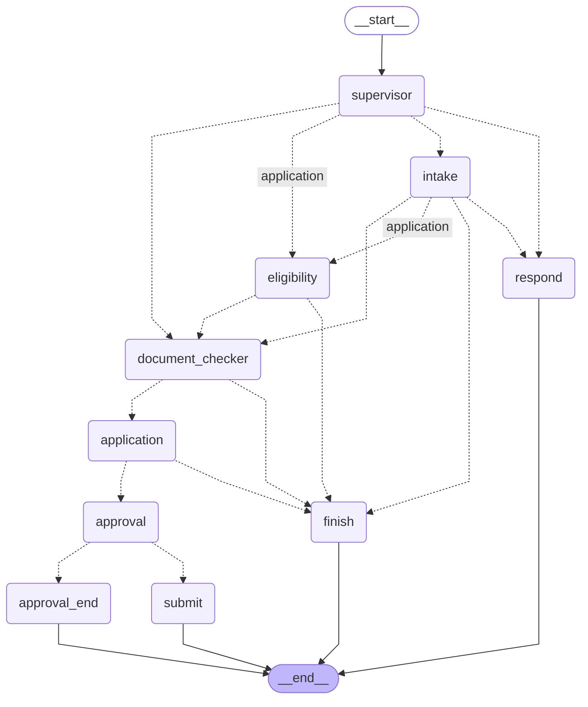

# Workflow graph

Generated from `graph/agent_workflow.py` by `python -m graph.diagram --write`; do not edit by hand.
Supervisor-first architecture: All requests flow through Supervisor FIRST for input validation,
language/intent detection, and routing to specialists (Intake, Eligibility, DocumentChecker, Application).
Dashed arrows are conditional edges based on Supervisor's routing decision.

