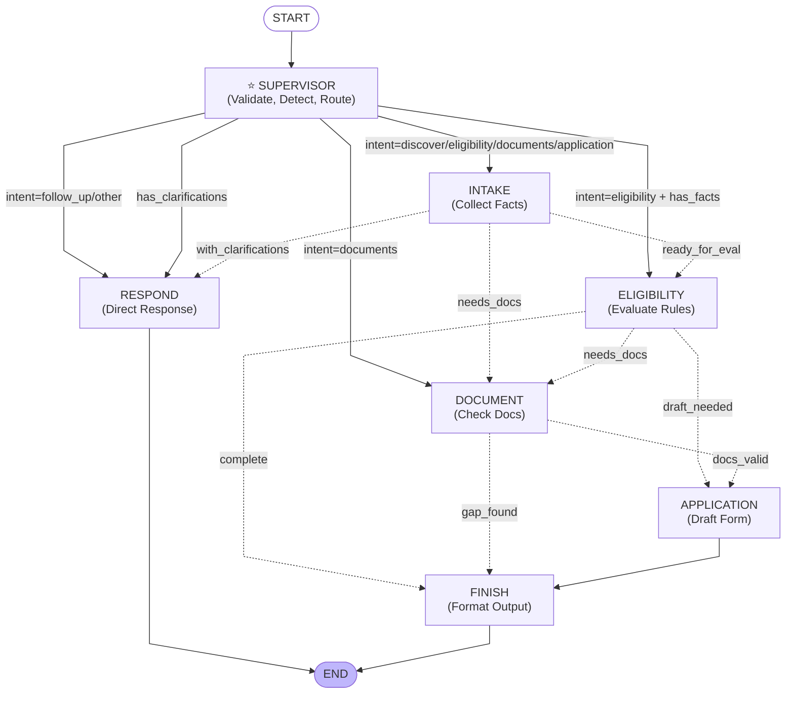

# Workflow graph

Generated from `graph/agent_workflow.py`; reflects Supervisor-first architecture (2026-11-03).

**CRITICAL ARCHITECTURE:** Supervisor is the MANDATORY entry point. All user requests flow through Supervisor FIRST for input validation, language/intent detection, and routing.

Dashed arrows are conditional edges based on routing decisions.

---

## Flow Details

**1. Supervisor (ALWAYS FIRST - Entry Point):**
- Validates input: sensitive data detection, rate limiting, message length
- Detects language (en/hi/mr) and intent (discover/eligibility/documents/application/follow_up/other)
- Routing decisions:
  - `discover` → Intake
  - `eligibility + no_facts` → Intake (collect first)
  - `eligibility + has_facts` → Eligibility (direct)
  - `documents` → DocumentChecker
  - `application` → Intake (collect facts first)
  - `follow_up / other` → Respond (direct response)
  - Has clarifying questions → Respond (pause for input)

**2. Intake (if Supervisor routes):**
- Collects household information
- If has clarifying questions → Respond (pause)
- Otherwise → next specialist (eligibility/document_checker) based on facts

**3. Eligibility (if needed):**
- Evaluates scheme eligibility based on rules
- Routes: → DocumentChecker (if application) or → Finish (if just evaluation)

**4. DocumentChecker (if needed):**
- Validates document presence and validity
- Routes: → Application (if docs valid) or → Finish (if gaps)

**5. Application (if needed):**
- Drafts application form for user review
- Routes: → Finish

**6. Respond (direct responses):**
- Handles clarifying questions from Intake (status: needs_clarification)
- Handles follow_up/other intents from Supervisor (status: responded)
- Routes directly to END (bypasses Finish to preserve response status)

**7. Finish (output formatting):**
- Formats response in user's detected language
- Applies post-check validation
- Routes: → END

---

## Key Architectural Guarantees

✅ **Supervisor is mandatory entry point** - No specialist executes without Supervisor routing
✅ **Input validation always first** - Before any specialist processing
✅ **Language-aware responses** - All output in user's detected language
✅ **Output validation always last** - Before returning to user
✅ **Respond bypasses Finish** - Preserves clarification status
✅ **All responses masked** - Sensitive data replaced before returning
